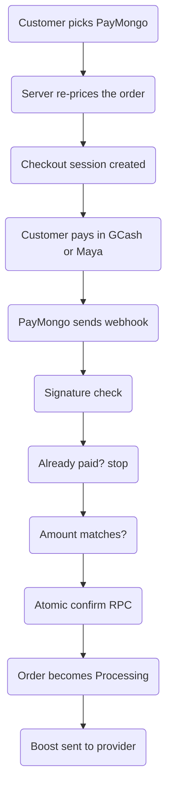

# PayMongo Integration Plan — PinoyBoosting SMM

> Status: **BUILT — wallet top-up rail only, test-mode keys first.**
> Owner's decision: PayMongo pays for **wallet top-up only** (never per-order),
> so a disputed boost never touches the gateway. Read the Compliance Warning first.
> Built files: `src/lib/paymongo.ts`, `src/app/api/paymongo/checkout|webhook|status`,
> `supabase/migrations/20260901000000_add_paymongo.sql`, PayMongo option in `src/components/TopUpModal.tsx`.
> Written to fit the code that exists today (Next.js 16 route handlers,
> Supabase service-role clients, RixeySMM auto-placement, order_events timeline).

---

## 0. Compliance warning (read this first)

PayMongo's Prohibited Businesses page names this category directly:

> "Sale of online traffic and engagement such as Twitter followers, Facebook
> likes, YouTube views, and other forms of social media activity and online
> traffic..."

That is the definition of an SMM panel. Adding PayMongo is therefore a **business
risk, not a technical one**. Technically it works fine. The account can be closed
and funds held if a review or a dispute touches it. The same clause appears in
most BSP-regulated gateways (Maya, Xendit) because the rule comes from card
network and bank policy.

**Recommendation:** keep the existing manual GCash/BPI receipt rail as the main
path. If PayMongo is added, restrict it to e-wallets (GCash/Maya) only — cards
have the highest chargeback rate for SMM orders.

---

## 1. What exists today (the seam)

| Rail | Route | Confirmed by |
|---|---|---|
| Wallet top-up | `POST /api/topup/create` | AI receipt check, else admin/Telegram |
| Per-order GCash/BPI | `POST /api/orders/create` + `POST /api/upload-receipt` | AI receipt check, else admin/Telegram |
| Wallet spend | `POST /api/checkout-wallet` | balance already credited (atomic RPC) |

Key facts the integration must respect:

- Orders are created as `Pending` (`src/app/api/orders/create/route.ts`).
- Money is credited/spent only through atomic Postgres RPCs:
  `create_wallet_order`, `approve_topup_atomic` (`supabase/migrations/20260612000002_atomic_money_and_receipts.sql`).
- Approved orders go `Processing` and are sent to the provider by
  `autoPlaceRixeyOrder(orderId, serviceId, targetUrl, quantity)` (`src/lib/rixeysmm.ts`).
- Every status change appends to the `order_events` timeline via
  `recordOrderEvent()` (`src/lib/orderEvents.ts`).
- Prices are always recalculated server-side with `resolveOrderPricing()`
  (`src/lib/orderPricing.ts`) — never trusted from the browser.
- Side effects run inside `after()` so the HTTP response is not blocked.
- Writes are mirrored to backup DBs via `dualWrite` / `syncBackupAdminClients`.

PayMongo becomes a **third rail**. It does not replace anything.

---

## 2. The core difference: no human in the loop

Today a human or an AI confirms every payment. With a gateway the **webhook
confirms payment**, so the approval gate disappears. That means:

> A PayMongo order must become `Processing` and be auto-sent to RixeySMM the
> moment the webhook lands — there is no way to keep an admin step without the
> customer waiting on a paid, stuck order.

Everything below is built around making that automatic step safe.

---

## 3. Files to add

### 3.1 `src/lib/paymongo.ts` — API client + signature check

```ts
// PayMongo REST base. All amounts are INTEGER CENTAVOS (PHP 50 => 5000).
const PAYMONGO_API = "https://api.paymongo.com/v1";

// Basic auth: secret key as username, empty password.
const authHeader = () =>
  "Basic " + Buffer.from(`${getPaymongoSecretKey()}:`).toString("base64");

export async function createCheckoutSession(input: {
  orderId: string;
  amountCentavos: number;
  description: string;
  customerEmail: string;
  successUrl: string;
  cancelUrl: string;
}) { /* POST /checkout_sessions */ }

export function verifyPaymongoSignature(rawBody: string, header: string | null) {
  // header: "t=1699999999,te=<hex>,li=<hex>"
  // signed payload = `${t}.${rawBody}`
  // HMAC-SHA256 with PAYMONGO_WEBHOOK_SECRET, compare to te (test) or li (live)
  // Use crypto.timingSafeEqual. Return false on any parse failure.
}
```

Rules for the client:
- **Read env through `requireEnv()`** from `src/utils/env.ts` so the existing
  whitespace/quoting cleaner applies.
- **Never** log the secret key or the raw signature.
- Send a **`Idempotency-Key`** header on session creation (`orderId`), so a
  double-click cannot create two payment intents.

### 3.2 `src/app/api/paymongo/checkout/route.ts` — start a payment

`POST` — authenticated, rate-limited with `enforceRateLimit` (key `paymongo-checkout`).

Flow:
1. `createServerClient()` → `auth.getUser()`. Reject if signed out.
2. Body: `{ orderId }` (order must exist, belong to `user.email`, status `Pending`).
3. **Re-resolve the amount on the server:** call `resolveOrderPricing()` +
   VIP + promo exactly as `orders/create` does. Never take an amount from the body.
4. `amountCentavos = Math.round(finalAmount * 100)`.
5. Create the Checkout Session with `success_url` / `cancel_url` back to your site.
6. Insert a `paymongo_payments` row (`status: 'pending'`, `order_id`, `amount`,
   `checkout_session_id`) and return `checkout_url`.

### 3.3 `src/app/api/paymongo/webhook/route.ts` — confirm a payment

`POST`, `export const runtime = "nodejs"` (needs `crypto` for HMAC).

**Order of operations — do not reorder:**

1. Read **raw body text first** (`await req.text()`). Signature is over the raw
   bytes — parsing to JSON first breaks it.
2. `verifyPaymongoSignature(raw, req.headers.get("paymongo-signature"))`.
   Bad signature → `401`, and **do nothing else**.
3. Parse JSON. Only handle `checkout_session.payment.paid` (and `payment.paid`).
4. **Idempotency:** look up the `paymongo_payments` row by the PayMongo event/session
   id. If it is already `paid`, return `200` immediately — a retried webhook must
   never credit twice.
5. **Amount re-check:** the paid `amount` (centavos) must equal the stored
   `paymongo_payments.amount`. Mismatch → mark `amount_mismatch`, notify admin, stop.
6. Call an **atomic RPC** `confirm_paymongo_order(...)` that, inside one
   transaction with `FOR UPDATE`:
   - flips the payment row `pending → paid` (returns early if already paid),
   - flips the order `Pending → Processing` with `payment_method = 'PayMongo'`,
   - returns the order id only if it actually changed.
7. After the RPC succeeds (inside `after()`):
   - `autoPlaceRixeyOrder(...)` — send to the provider,
   - `recordOrderEvent(... 'payment_received')` + `'processing'`,
   - `sendOrderNotification` (Telegram) + `sendOrderPlacedEmail`,
   - `creditReferralCommission(...)`,
   - `syncBackupAdminClients(...)` to mirror the order and payment row.
8. Failed/expired events: mark the payment row `failed`/`expired`, leave the order
   `Pending` so the customer can retry or use a receipt.

Return `200` fast for anything already handled, so PayMongo stops retrying.

### 3.4 Migration `supabase/migrations/2026XXXXXXXX_add_paymongo.sql`

```sql
CREATE TABLE IF NOT EXISTS paymongo_payments (
  id UUID DEFAULT gen_random_uuid() PRIMARY KEY,
  order_id UUID REFERENCES orders(id) ON DELETE CASCADE,
  user_id UUID,
  email TEXT,
  amount NUMERIC NOT NULL,            -- pesos, for display
  amount_centavos INTEGER NOT NULL,   -- what PayMongo actually charged
  payment_method TEXT,                -- gcash | maya | card | qrph
  checkout_session_id TEXT UNIQUE,
  payment_intent_id TEXT,
  paymongo_event_id TEXT UNIQUE,      -- idempotency key
  status TEXT NOT NULL DEFAULT 'pending'
    CHECK (status IN ('pending','paid','failed','expired','amount_mismatch','refunded')),
  raw_event JSONB,
  created_at TIMESTAMPTZ DEFAULT NOW(),
  paid_at TIMESTAMPTZ
);

CREATE INDEX IF NOT EXISTS idx_paymongo_order ON paymongo_payments(order_id);
CREATE INDEX IF NOT EXISTS idx_paymongo_event ON paymongo_payments(paymongo_event_id);

ALTER TABLE paymongo_payments ENABLE ROW LEVEL SECURITY;
-- No anon/authenticated policies: service role only, same as the other money tables.

CREATE OR REPLACE FUNCTION confirm_paymongo_order(
  p_order_id UUID,
  p_event_id TEXT,
  p_centavos INTEGER,
  p_method TEXT,
  p_raw JSONB
) RETURNS TABLE(confirmed BOOLEAN, order_id UUID)
LANGUAGE plpgsql SECURITY DEFINER SET search_path = public AS $$
DECLARE v_row paymongo_payments; v_order orders;
BEGIN
  -- lock the payment row
  SELECT * INTO v_row FROM paymongo_payments
   WHERE paymongo_event_id = p_event_id FOR UPDATE;

  IF FOUND AND v_row.status = 'paid' THEN
    RETURN QUERY SELECT FALSE, v_row.order_id;   -- already processed, no-op
    RETURN;
  END IF;

  IF NOT FOUND THEN
    -- event id unknown: insert-or-ignore, then re-read
    INSERT INTO paymongo_payments (order_id, amount_centavos, paymongo_event_id, status, raw_event)
    VALUES (p_order_id, p_centavos, p_event_id, 'pending', p_raw)
    ON CONFLICT (paymongo_event_id) DO NOTHING;
    SELECT * INTO v_row FROM paymongo_payments WHERE paymongo_event_id = p_event_id FOR UPDATE;
    IF v_row.status = 'paid' THEN RETURN QUERY SELECT FALSE, v_row.order_id; RETURN; END IF;
  END IF;

  -- amount must match the server-resolved price
  IF v_row.amount_centavos <> p_centavos THEN
    UPDATE paymongo_payments SET status='amount_mismatch' WHERE id = v_row.id;
    RETURN QUERY SELECT FALSE, NULL::UUID; RETURN;
  END IF;

  -- lock and flip the order only if still Pending
  SELECT * INTO v_order FROM orders WHERE id = v_row.order_id FOR UPDATE;
  IF v_order.status <> 'Pending' THEN
    UPDATE paymongo_payments SET status='paid', paid_at=NOW() WHERE id = v_row.id;
    RETURN QUERY SELECT FALSE, v_order.id; RETURN;   -- already handled elsewhere
  END IF;

  UPDATE orders SET status='Processing', payment_method='PayMongo'
   WHERE id = v_order.id;

  UPDATE paymongo_payments
     SET status='paid', paid_at=NOW(), payment_method=p_method, raw_event=p_raw
   WHERE id = v_row.id;

  RETURN QUERY SELECT TRUE, v_order.id;
END; $$;

REVOKE ALL ON FUNCTION confirm_paymongo_order(UUID,TEXT,INTEGER,TEXT,JSONB) FROM PUBLIC, anon, authenticated;
GRANT EXECUTE ON FUNCTION confirm_paymongo_order(UUID,TEXT,INTEGER,TEXT,JSONB) TO service_role;
```

### 3.5 Env vars (Vercel + `.env.local`)

```
PAYMONGO_SECRET_KEY=sk_live_...      # server only, never NEXT_PUBLIC
PAYMONGO_PUBLIC_KEY=pk_live_...      # only if you embed the JS widget
PAYMONGO_WEBHOOK_SECRET=whsk_...     # from the PayMongo dashboard webhook
```

Never prefix the secret or webhook secret with `NEXT_PUBLIC_` — that would ship
them to the browser.

### 3.6 UI touch points (small)

- Add a "Pay with GCash/Maya" button next to the receipt upload on the order page.
- Show `payment_method = 'PayMongo'` in admin and in the `order_events` timeline
  (already handled by the generic event label).
- `orderEventLabel()` needs no change: `payment_received` already reads
  "Payment received".

---

## 4. Flow



---

## 5. Security checklist (all mandatory)

- [ ] **Signature verified** on every webhook, over the raw body, timing-safe compare.
- [ ] **Idempotent** — same event id never credits twice; DB unique constraint backs it.
- [ ] **Amount re-checked** against the stored `amount_centavos`, not the browser's number.
- [ ] **Order ownership checked** at session creation (`user.email` matches order).
- [ ] **Price resolved server-side** at session creation — the body never carries an amount.
- [ ] **Webhook route is public** but does nothing except verify, then react.
- [ ] **Secrets server-only**; no `NEXT_PUBLIC_` prefix; never logged.
- [ ] **Failed/expired** payments leave the order `Pending`, never `Processing`.
- [ ] **Refunds** go back through PayMongo's refund API *and* mirror the existing
      `refundOrderToWallet` behaviour so the ledger stays consistent.

---

## 6. Go-live order

1. Apply the migration on primary + every backup DB.
2. Add env vars to Vercel (preview first, then production).
3. Deploy, then register the webhook URL in the PayMongo dashboard:
   `https://pinoyboosting.com/api/paymongo/webhook`.
4. Test with `test` mode keys and PayMongo's test cards / e-wallet sandbox.
5. Only then switch to `sk_live_`.

---

## 7. Open questions for the owner

1. PayMongo for **wallet top-up only**, or **per-order** too? (Top-up-only is safer:
   the money sits as balance, and a disputed order never touches the gateway.)
2. Restrict to **e-wallets only** (drop cards entirely)?
3. Keep a **manual review** for first-time customers above a peso threshold?
4. Crypto as the second rail instead of cards?
