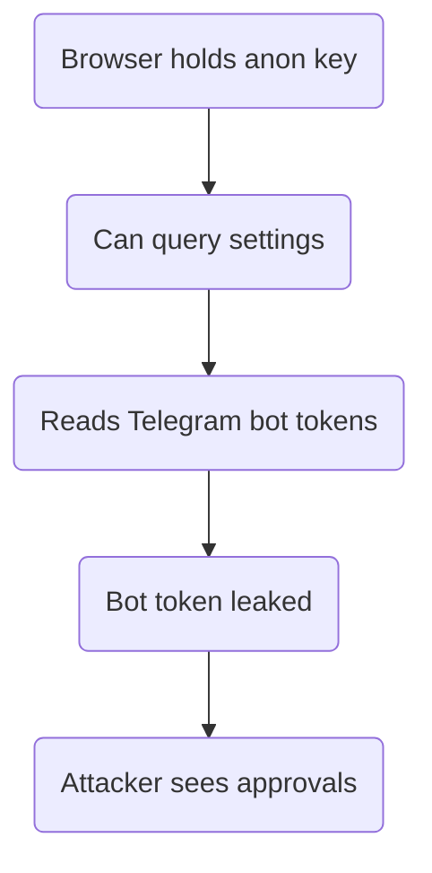
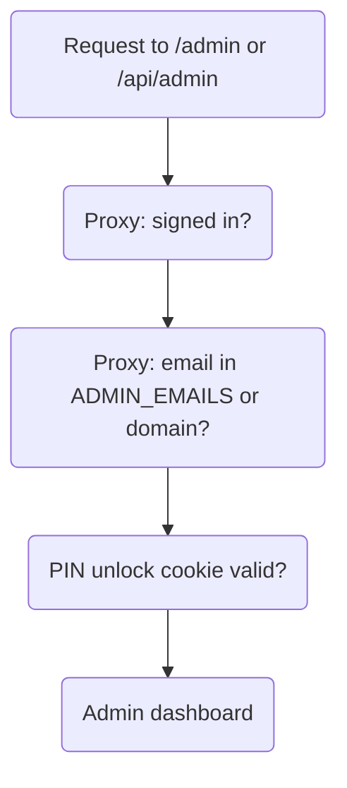

# PinoyBoosting — Deep Study (Part 3: Security, Auth, Delivery)

> Third pass. Part 1 (`docs/project-study.md`) covered money, data and the
> supplier. Part 2 (`docs/project-study-ui-and-ai.md`) covered the UI, admin
> panels, chatbot and mobile shell. This part covers the layers both skipped:
> **identity and auth, admin access control, rate limiting, the `settings`
> table as an attack surface, delivery/realtime, and the AI provider chain.**
>
> Everything here was read from the source files in this repo.

---

## 0. Verified corrections to the earlier docs

Two claims in Part 1 do not match the code and should be read with care:

| Part 1 said | The code actually does |
|---|---|
| "`SpyQueryBuilder` only implements `eq`, `order`, `limit`, `single`, `maybeSingle`" | It also **skips live reads of the primary database**. `fallbackRead()` only returns a DigitalOcean result when `data != null`; an empty result is treated as a miss and the read continues to Supabase. |
| "`dualWrite()` writes to DigitalOcean first, then every backup; if the primary fails the first backup is used" | Correct — **but** there is a strong bias that makes a silent backup write unlikely for the tables that matter. `SpyQueryBuilder.execute()` always runs the DigitalOcean statement *and* the Supabase statement, then **returns the DigitalOcean result even when it errored**. So a "primary down" write usually surfaces as a real error, not a silent split. |

The practical split-brain risk is therefore **smaller** than Part 1 implied, and
the **empty-read fallback** risk is **larger** than part 1 mentioned. Both are
covered below.

---

## 1. The `settings` table is the whole app's control panel — and it is unprotected

Every configurable behaviour lives as one row in `settings` (key → JSONB):

| Key | What it controls |
|---|---|
| `maintenance_mode` | Site-wide lockout |
| `markup_config` | Price multiplier over provider cost |
| `telegram_order_config` | **Order bot token + chat id** |
| `telegram_topup_config` | **Top-up bot token + chat id** |
| `hero_text`, `hero_video`, `showcase_video`, `services_bg` | Public look |
| `mobile_app_settings` | App version + update message |
| `admin_security` | Admin email allowlist override |

**Finding — HIGH: `settings` is never given row level security.**
`ALTER TABLE settings ENABLE ROW LEVEL SECURITY` appears in **no** migration
(`grep` over `supabase/migrations/*.sql` returns nothing for `settings`). The
`/api/admin/init-db` bootstrap only creates the table *if missing*, and the
policy it writes is:

```sql
CREATE POLICY "Allow service role" ON public.settings
  FOR ALL USING (true) WITH CHECK (true);
```

There is no `TO service_role` clause, so that policy applies to **every role**,
including `anon`. On a default Supabase project the `anon` role also has table
grants. `settings` rows are read by server code with the service role — but the
**anon key ships to the browser** (`NEXT_PUBLIC_SUPABASE_ANON_KEY`), so anyone
can query `settings` directly with it.

That exposes the **Telegram bot tokens** (`telegram_order_config`,
`telegram_topup_config`). A leaked bot token lets a stranger read the approval
chat and, with the `telegram/webhook` secret, could impersonate approvals.

The codebase already knows this: `20260624000000_create_admin_secrets.sql`
says it in a comment —

> "the public `settings` table, whose 'Service role full access' policy is
> actually permissive to all roles. A 4-digit PIN hash stored there could be
> brute-forced offline by anyone with the public anon key, so the PIN lives here
> instead."

**The PIN was moved out. The Telegram tokens were not.**

### Fix (small, safe)

1. Move `telegram_order_config` and `telegram_topup_config` into `admin_secrets`
   (same pattern as the PIN), **or**
2. Enable RLS on `settings` and drop the blanket policy, then add a
   `TO service_role` policy only. Public keys (`hero_text`, `maintenance_mode`,
   `mobile_app_settings`) then need a separate public-read view or must be read
   through an API route.

Option 1 is the smaller change and matches an existing, working pattern.



---

## 2. Identity and auth

Auth is **Supabase Auth**, but almost nothing is done through the built-in
mailer. The custom pieces:

| Concern | Where | Note |
|---|---|---|
| Sign-up | `api/auth/signup` | Creates the user with `email_confirm: false` |
| OTP email | `utils/auth/otp.ts` → Resend | Sent by the app, not Supabase |
| Verify | `api/auth/verify-otp`, `verify-email` | |
| Forgot password | `api/auth/forgot-password` | Resend link → `/auth/confirm` |
| User lookup | `utils/auth/find-user.ts` | Three strategies |

**Good:** `find-user.ts` is genuinely defensive. It tries
`profiles.email` (indexed, fast) → GoTrue admin `filter` → bounded pagination
(capped at 200 pages × 100 = 20k users). Each step verifies an **exact** email
match, so a substring match can never resolve the wrong account.

**Good:** `signup/route.ts` carries a large disposable-domain blocklist, a
role-based username blocklist and a typo-correction map for common Gmail
misspellings — real anti-abuse work.

**Risk (LOW):** because Supabase sends nothing, **email delivery is a single
point of failure**. If the Resend key is missing or the domain verification
lapses, nobody can confirm a new account — and the UI has historically shown
"code sent" anyway.

---

## 3. Admin access control — layered, and correctly fail-closed

Admin protection has **three independent layers**, which is more than most
projects at this size:



1. **Proxy (`src/proxy.ts`)** — checks the Supabase session, then
   `isAdminEmail()` (`ADMIN_EMAILS` allowlist, else `ADMIN_EMAIL_DOMAIN`, else
   a built-in default). Wrong email → redirect to `/`; for `/api/admin/*` →
   401/403 JSON.
2. **PIN gate (`lib/adminPin.ts`)** — a 4-digit PIN hashed with **scrypt** +
   random salt, verified with `timingSafeEqual`, stored in `admin_secrets`
   (service-role only). After 5 wrong tries, a 5-minute lockout. The unlock
   cookie is an **HMAC-SHA256 signed, expiring token** — not a plain flag.
3. **`fail closed`** — the proxy wraps the auth client in a try/catch. If
   Supabase env vars are malformed, admin areas return **503** while public
   pages keep serving. This is the correct direction.

**Inconsistency (LOW):** `api/admin/pin/route.ts` has its own
`requireAdmin()` that hardcodes `email.endsWith("@boostsocial.com")` instead of
using `isAdminEmail()`. If `ADMIN_EMAILS` is configured with a different domain,
the PIN endpoint will reject the very admin the proxy lets in.

**Note:** a 4-digit PIN is only 10,000 combinations. scrypt + the 5-try lockout
make online guessing impractical, which is the right call.

---

## 4. Rate limiting — correct shape, wrong storage

`utils/security/rate-limit.ts` keeps a `Map` **in module memory** keyed by
`bucketKey = key:clientIp`, reading `x-forwarded-for` (falling back to
`x-real-ip`).

Endpoints covered: `orders-create` (20/min), `checkout-wallet` (20/min),
`upload-receipt` (20/10min), `checkin` (5/min), `telegram-webhook` (120/min).

**Finding — MEDIUM:** on Vercel each serverless instance has its **own** Map.
With N warm instances a limit of 20/min is effectively up to 20×N/min, and a
cold start resets the counters. This does not break anything today, but it is
not a real limit under load or under a determined abuser. A shared store
(Upstash Redis, or a Postgres counter table) is the fix when traffic justifies
it.

**Client IP trust (LOW):** `x-forwarded-for` is read from the left-most value.
On Vercel the platform sets this header, so it is reliable there — but the code
would trust a client-supplied value on any host that does not strip it.

---

## 5. The supplier pipeline — what Part 1 did not mention

`autoPlaceRixeyOrder()` already queues and retries well. Three extra details
matter:

- **The retry cron only looks at `status = 'Processing'`.**
  `retry-queued-orders` filters `.eq("status", "Processing")`. A paid order that
  somehow sits in another status with no `external_order_id` is never retried.
- **`markPlacementAttempt()` runs on every path**, including a successful
  placement — so `last_attempt_at` is a general "last touched" stamp, and the
  30-minute guard also protects a *successfully placed* order from being
  re-sent. That is the intent, and it works, but it means the cron's
  `.is("external_order_id", null)` filter is the real dedupe guard.
- **Link uniquification changes the URL the provider sees** (`?t=<ts>_<rand>`).
  Part 1 flagged this as a trade-off. Worth adding: it also means the provider's
  own dedupe and any "same link" analytics are permanently defeated, and some
  platforms treat unknown query params as different URLs — occasionally a
  legitimate service will count the traffic on a link the customer did not
  hand out. It is deliberate, but it is a behaviour to document for support.

---

## 6. The AI chain — three providers, one budget

`lib/neuralwatt.ts` (the name is historical) is an OpenAI-compatible client:

- **Primary:** `COMMANDCODE_*` (base URL, key, chat + vision model).
- **Fallback:** `OPENROUTER_*` (free router).
- **Legacy aliases:** `NEURALWATT_*` still read, so an old config keeps working.

Notable engineering, all verified:

- **Env hardening:** `normalizeEnvValue()` strips a stray `KEY=value` prefix and
  quotes — this exists because a hosting dashboard once stored the whole
  assignment in the value field and silently broke every AI call.
- **Malformed base URL is rejected before use** (`validBaseUrl`), so the chain
  moves to the next provider instead of failing inside `fetch`.
- **Retries are bounded:** retryable statuses are `402/408/429/500/502/503`,
  2 attempts per provider, exponential backoff capped at 5s.
- **A timeout is final.** `requestNeuralwattChat()` only falls through to the
  next provider on a *retryable* API error or 401/403 — never on an abort. The
  comment explains why: a second 45s attempt would outlive the route's 60s
  limit and be killed, losing the reason.
- **Empty-content handling:** if a reasoning model burns its whole budget on
  thinking (`finish_reason == "length"`, no `content`), it retries once with 4×
  the budget (ceiling 4096), and only if ≥4s remain. If content is still empty it
  falls back to the model's **reasoning text** rather than returning nothing.

**Finding — LOW:** `api/ai-search/route.ts` is a **different, older path**: it
calls `https://text.pollinations.ai/openai` directly with no API key and a 9s
timeout, bypassing the hardened chain entirely. It also uses a fixed
`model: "openai"`. That endpoint is a third-party free service — no key, no
contract, and it receives the customer's search query. Worth consolidating onto
the `neuralwatt` client for one place to manage providers.

**Finding — LOW:** the AI-search system prompt tells the model to use Taglish
"only when natural", but the deterministic fallback (`fallbackExplanation`) is
plain English. A customer can get two different tones for the same question
depending on whether the provider answered.

---

## 7. Delivery: realtime, push, Telegram, email

| Channel | Implementation | Note |
|---|---|---|
| Realtime chat | `customer_messages` + `useCustomerMessagesRealtime` | RLS enabled; policies restrict customers to their own rows and admins to all |
| Web Push | `web-push` + VAPID | Subscription keyed on unique `endpoint`, RLS scoped to `auth.uid() = user_id` |
| Telegram | Two bots, per-flow config | Webhook validated by `x-telegram-bot-api-secret-token`, **fails closed at 500 when the secret is unset** |
| Email | Resend | OTP, reset, order placed/approved/completed, top-up approved, check-in |

**Good:** the receipt bucket has `file_size_limit = 8MB` and an explicit MIME
allowlist (`image/jpeg|png|webp`) enforced at the **bucket** level, not just in
the route. The route re-checks the same limits.

**Good:** the Telegram webhook compares the secret with a plain `!==` but the
value is high-entropy and the header is platform-set — acceptable here.

**Medium:** the receipt bucket is **publicly readable**. That is necessary (the
stored URL is used in Telegram and admin views) but it means every uploaded
GCash proof is reachable by anyone who can guess a filename. Filenames include a
SHA-256 hash, so guessing is impractical — but the bucket is not private by
design, it is private by hash. Consider signed URLs if receipts ever contain
more than a reference number.

---

## 8. Consolidated risk register

| # | Priority | Finding | Fix |
|---|---|---|---|
| 1 | **High** | `settings` has **no RLS**; Telegram bot tokens are readable with the public anon key | Move both `telegram_*_config` rows to `admin_secrets`, or RLS + `TO service_role` policy |
| 2 | Medium | Rate limiter is per-instance memory | Shared store (Redis/Postgres) when traffic grows |
| 3 | Medium | Retry cron only sees `status='Processing'` | Widen the filter to "no `external_order_id` + provider queued/failed" |
| 4 | Medium | Receipt bucket is publicly readable | Accept (hash-named) or move to signed URLs |
| 5 | Medium | `fallbackRead` treats an empty primary result as a miss | Distinguish "no rows" from "primary down" before falling back |
| 6 | Low | `ai-search` bypasses the hardened AI chain | Route it through `neuralwatt.ts` |
| 7 | Low | PIN route hardcodes `@boostsocial.com` | Use `isAdminEmail()` |
| 8 | Low | Email delivery is a single point of failure | Alert when the Resend key is missing |
| 9 | Low | Inconsistent tone between AI answer and fallback | Make the fallback Taglish too |

---

## 9. What is genuinely well built (this pass)

- **Admin access is three independent layers**, and it fails **closed** for
  admin areas while failing **open** for public pages. That is exactly right.
- **The admin PIN** uses scrypt + salt + `timingSafeEqual`, a signed expiring
  cookie, and a lockout — not a plain-text compare and a boolean cookie.
- **`find-user.ts`** never trusts a substring match; it verifies an exact email
  at every step and bounds its own worst case.
- **The AI client** bounds its retries, treats a timeout as final, recovers from
  reasoning-only responses, and survives a mis-entered environment variable.
- **Secret-token validation on the Telegram webhook fails closed** (500 when the
  secret is unset) instead of accepting anything.

---

## 10. One-line summary

Parts 1 and 2 showed a **locked-down money engine** and a
**database-driven app**. Part 3 shows the **perimeter**: the admin gate is
genuinely well made, the AI chain is carefully bounded, auth is defensive — and
**the single biggest weakness is that the `settings` table, which holds the
Telegram bot tokens, was never given row level security**, while the PIN was
moved out of it for exactly that reason.
