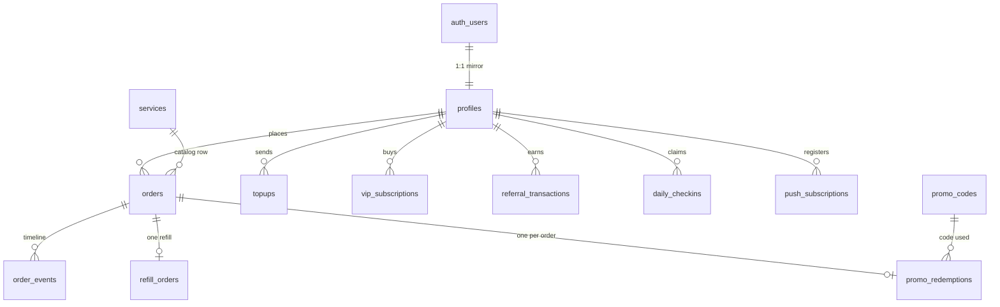
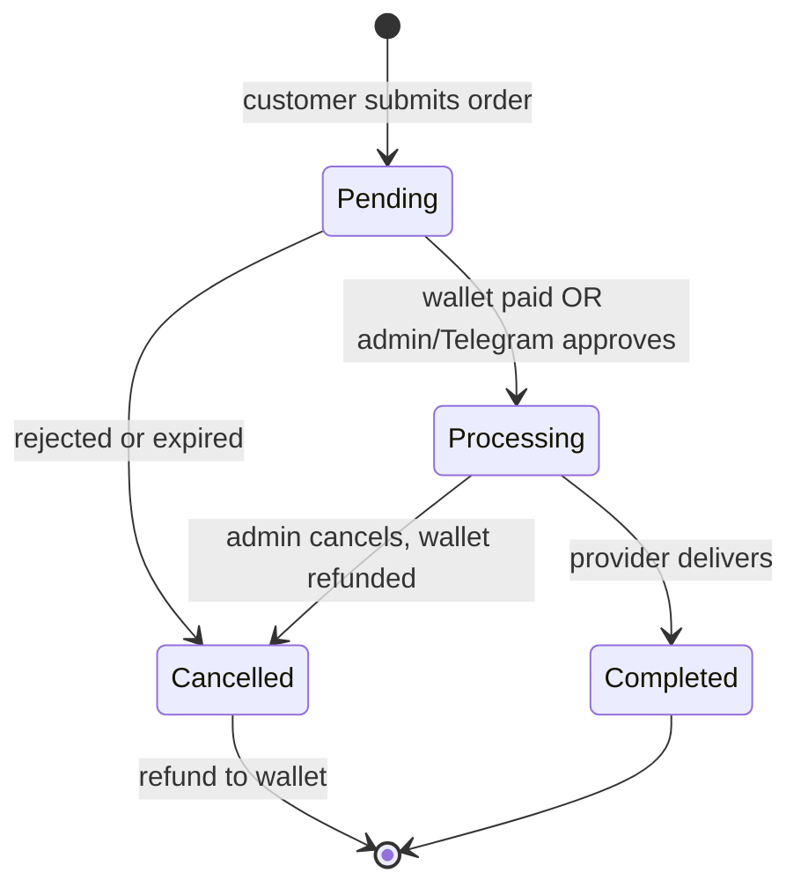
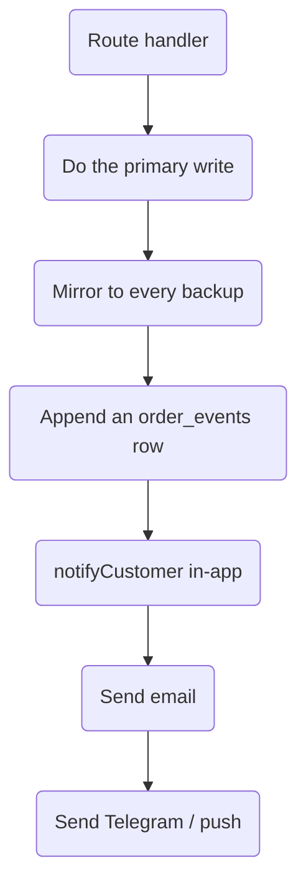

# PinoyBoosting — Deep Study (Part 4: Data Model, Order Lifecycle & Growth Loops)

> Fourth pass. Part 1 (`docs/project-study.md`) covered money, data and the
> supplier. Part 2 (`docs/project-study-ui-and-ai.md`) covered the UI, admin
> panels, chatbot and mobile shell. Part 3 (`docs/project-study-part-3.md`)
> covered security, auth, rate limiting and delivery.
>
> This part covers what all three skipped: **the actual database schema, the
> order state machine end to end, the referral/promo/check-in growth loops, the
> email layer, and the one code pattern that repeats in every feature.** Every
> claim below was read from a file in this repo, with the path given.

---

## 0. Verified corrections to earlier parts

| Earlier part said | The code actually does now |
|---|---|
| Part 1/3: retry cron only looks at `status = 'Processing'` and never retries other statuses | **Fixed.** `src/app/api/cron/retry-queued-orders/route.ts` now filters `.eq("status","Processing").is("external_order_id", null)` **and** `.or("external_status.ilike.Queued:%,external_status.ilike.Failed:%")`. It also throws a separate `external_status` column instead of packing the queue reason into `status`. The old risk is closed. |
| Part 3: receipts are hashed against `orders`, `topups`, `vip_subscriptions` | Correct — and `src/lib/receiptGuard.ts` confirms the inactive-status rule (`rejected / cancelled / failed / declined / voided`) applies to **all three** tables. |

---

## 1. The real data model

The schema lives in `supabase/migrations/` (14 files) and grows by adding tables
in "feature" migrations (`20260806000000_feature_suite.sql` is the big one).
Money tables all hang off `profiles`, which mirrors `auth.users`.

Things worth knowing about the tables:

- **`profiles` is the money table.** `balance NUMERIC(10,2)` is the wallet.
  `vip_plan`, `vip_started_at`, `vip_expires_at` are denormalised onto it, so VIP
  state is read in one row — no join.
- **`orders` carries both our status and the provider's.** `status` is ours
  (`Pending → Processing → Completed / Cancelled`), `external_order_id` is
  RixeySMM's id, `external_status` is a free-text provider state string.
- **`settings` is one row per key, `value JSONB`.** Every admin panel is a
  front end for this table (Part 2). It also holds the low-balance provider
  alert cooldown (`rixeysmm_low_balance_alert`) — see `providerBalanceMonitor.ts`.
- **`order_events` is an append-only timeline**, one row per state change, with
  `from_status`, `to_status` and a human `detail` (see §3).
- **`payouts` still exists and still has no reader or writer in `src/`.** It is
  dead schema carried from the very first migration.
- **Referral earnings and daily check-ins credit `profiles.balance` twice**
  (once for real, once for the backup) — see §4.

---

## 2. The order lifecycle, end to end

This is the single most important flow in the app, and it is spread across five
files. Here it is in one picture:

And the code that drives each arrow:

| Step | File | What happens |
|---|---|---|
| Create | `src/app/api/orders/create/route.ts` | Re-prices server-side, inserts `Pending`, records a `created` event, emails the customer. GCash orders wait for a receipt. |
| Pay from wallet | `src/app/api/checkout-wallet/route.ts` | Calls `create_wallet_order` RPC — atomic deduct + order create in one transaction. |
| Approve | `src/app/api/admin/approve-topup`, `update-order-status`, Telegram webhook | Flips to `Processing`, then `after()` sends it to the provider. |
| Place with provider | `src/lib/rixeysmm.ts` | Balance preflight → link uniquify → POST → save `external_order_id`. On funding error it writes `external_status = 'Queued: …'` and leaves `status = 'Processing'` for the cron. |
| Retry | `src/app/api/cron/retry-queued-orders` | Every 30 min, re-sends `Processing` orders that have no `external_order_id` and a `Queued:`/`Failed:` external status. |
| Cancel | `src/lib/orderRefund.ts` | `credit_wallet_atomic` RPC refunds the wallet, then mirrors the new balance to backups. |

**Sharp edges in this flow:**

1. **The queue reason used to live in `status`.** Today it is only written to
   `external_status` (`markOrderQueuedForProviderFunding` in `src/lib/rixeysmm.ts`
   updates `external_status` and leaves `status = 'Processing'`). If any
   historical row still carries `Queued: …` inside `status`, the new cron filter
   would miss it — worth one count query before deciding on a backfill.
2. **The wallet refund itself is safe** — `orderRefund` calls the locked
   `credit_wallet_atomic` RPC, then mirrors the new balance to backups. The
   read-then-write risk in this area is in the **referral** credit, not the
   refund (see §4.1).
3. **Refunds never leave the platform.** Money goes back to the wallet only —
   confirmed in Part 1, still true.

---

## 3. The `order_events` timeline — the healthiest seam in the app

`src/lib/orderEvents.ts` is small and does three things well:

- **It never throws into the caller's path.** Both the primary insert and the
  backup sync are wrapped in try/catch and only `console.warn`.
- **It mirrors the same row object** to the primary and to every backup, so the
  backup has the same `created_at` — no clock skew between databases.
- **It has a typed event list** (`OrderEventType`) with a `orderEventLabel()`
  function that maps each to friendly text for the customer UI.

`provider_queued`, `provider_submitted`, `provider_completed` exist as event
types — so the app can show a real "sent to provider / provider delivered"
timeline, not just our own status.

---

## 4. The growth loops (referrals, promos, check-ins)

These three are new since Parts 1–3 and are where the "reseller" business model
lives.

### 4.1 Referral program — `src/utils/referrals.ts`

Tiers come from `src/utils/referral-program.ts`:

| Tier | Unlocks at referral spend | Order commission | Top-up commission |
|---|---|---|---|
| Basic Reseller | ₱0 | 5% | 10% |
| Pro Reseller | ₱5,000 | 10% | 12% |
| Elite Reseller | ₱20,000 | 15% | 15% |

**How a commission is credited** (`creditReferralCommission`):
1. Find the customer's profile; if `referred_by` is empty, stop.
2. Check for an existing `[ref:order:<id>]` marker in
   `referral_transactions.description` — the idempotency guard.
3. Read the referrer's `balance`, add the commission, write it back.
4. Insert a `referral_transactions` row, then repeat all of it on each backup.

**Finding — MEDIUM (double credit on backups).** The marker check and the
balance update happen **per client**. On the primary it is safe. But
`syncBackupAdminClients` re-runs `creditOnClient` on each backup, and the
marker only exists on the database that already has it. For a **registered**
customer the primary copy is found and skipped, so normal traffic is fine. The
edge case is a customer that exists **only** on a backup (the empty-read
fallback of Part 3): the commission would then be credited on that backup
independently. Not a live bug, but the guard is per-database, not global.

**Finding — MEDIUM (read-then-write balance, no lock).** Step 3 above is
`balance = read + commission` in JS. Unlike `credit_wallet_atomic` (which locks
the row), this is a classic lost-update. Two commissions landing at the same
moment can drop one. Fix: move referral crediting onto `credit_wallet_atomic`
with the marker written in the same transaction.

### 4.2 Promo codes — `src/lib/promo.ts`

Well-guarded overall: format regex, active flag, expiry, usage cap,
`min_order_amount`, service/category scope, and a **cap** on both the percent
(100%) and the fixed discount (₱50,000) so a mis-entered code cannot zero a
wallet.

**Finding — LOW (usage cap is soft).** `recordPromoRedemption` increments
`used_count` with a conditional `.lte("used_count", maxUses - 1)`, which is
race-safe, **but binding happens at redemption, not at validation**. Many
customers can pass validation at `max_uses = 1`, then all create `Pending`
orders — the ones that lose the race still hold a discount. A hard cap needs the
increment moved into the order-create transaction.

**Finding — LOW (`applies_to` scope can be skipped).** The scope check only
rejects when the caller *passes* a `serviceId`/`category`. If a route calls
`validatePromoCode` without a `serviceId`, a `service_id:`-scoped promo passes.
Scope is only as strong as the caller's arguments.

### 4.3 Daily check-in — `src/app/api/checkin/route.ts`

Genuinely well built, and worth copying as the reference pattern:

1. Insert `daily_checkins` with a `UNIQUE(user_id, checkin_date)` — the DB, not
   code, is the duplicate guard.
2. Credit the wallet with `credit_wallet_atomic` (locked).
3. **If the credit fails, it deletes the check-in row** so the customer can
   retry — a manual rollback where a transaction would be better, but the intent
   is right.
4. Reward amount reads from `settings.customer_alerts.rewardAmount` (default ₱5),
   so the bonus is admin-tunable without a deploy.

---

## 5. The deterministic chatbot offers — `src/lib/chatOffers.ts`

Part 2 described the AI chatbot. This file is the **non-AI** half: it decides
which services the bot may offer *before* any model is called.

- Intent is matched by **alias sets**, not AI: platform (`facebook/fb/meta`,
  `tiktok/tik tok`, …) × intent (`followers/follow`, `likes/heart`, `views/plays`,
  `reactions/love`…), plus "cheapest/budget/mura/barato" and "all services".
- `selectChatOfferCandidates` returns **one cheapest** matching service;
  `selectAllChatOfferCandidates` returns the whole filtered catalog.
- `validCatalogService` drops any row with no id, non-positive price, or a max
  below its min — so a malformed catalog row can never be quoted.
- `BLOCKED_SERVICE_IDS` is an **empty** safety net with a comment explaining why
  (the live catalog already omits delisted services).

This is why the bot can quote a price with **no AI involved** — the price comes
from the live catalog + alias matching, and the model only writes the sentence.

---

## 6. Email — one file, seven templates

`src/lib/approvalEmails.ts` holds **seven** customer emails, all plain
`text` + hand-written `html`, all through `sendAuthEmail`:

| Email | Trigger |
|---|---|
| `sendOrderPlacedEmail` | order created (includes GCash steps) |
| `sendOrderApprovedEmail` | approval → processing |
| `sendOrderCompletedEmail` | provider delivered |
| `sendTopupApprovedEmail` | wallet topped up |
| `sendTopupPlacedEmail` | top-up receipt uploaded, awaiting review |
| `sendLowBalanceEmail` | cron low-balance reminder |
| `sendCheckInEmail` | daily bonus claimed |
| (auth) OTP / reset | `src/utils/auth/email.ts` |

**Good — every template has a plain-text version.** That is the single most
important deliverability decision, and it is done everywhere. Every user value
is passed through `escapeHtml()` before it reaches the HTML body.

**Finding — LOW (the money word).** Every template shows amounts as
`PHP 123.45`, not `₱123.45`. The site shows the peso sign; the email says "PHP".
Cosmetic, but it is the kind of thing a customer notices first.

**Finding — LOW (single point of failure, restated).** All of these go through
`sendAuthEmail` → Resend. If that key is missing or the domain unverifies, order
confirmations, receipts, low-balance nudges and check-in rewards all stop at
once, silently (every caller `.catch()`es and logs). There is no alert when it
breaks.

---

## 7. The one pattern that repeats in every feature

Almost every new feature follows the same shape, and this is the most useful
thing to internalise about the codebase:

Every one of those steps after the primary write is **fire-and-forget** with a
`.catch()` or `.then()` — so a broken backup, a dead email key or a Telegram
outage degrades the feature but never fails the customer's request. This is why
the app is resilient, and why problems can be **invisible**: the same design that
keeps orders working also swallows the signal that something is down.

**The trade-off to remember:** no delivery step has a health check or an alert.
The right addition is a small "last successful email / last backup sync" stamp
in `settings` and one admin dashboard row showing it.

---

## 8. Consolidated risk register (this pass)

| # | Priority | Finding | Fix |
|---|---|---|---|
| 1 | **Medium** | Referral balance update is read-then-write, not locked | Move onto `credit_wallet_atomic` |
| 2 | **Medium** | Referral idempotency marker is per-database | Global guard, or single source of truth |
| 3 | **Medium** | No alert when email or backup sync stops working | Health stamp in `settings` + admin row |
| 4 | Low | Promo usage cap binds at redemption, not validation | Increment inside order-create transaction |
| 5 | Low | Promo `applies_to` scope needs the caller to pass `serviceId` | Pass scope context from every caller |
| 6 | Low | Any pre-`external_status` row may keep `Queued:` inside `status` | One count query, then backfill if needed |
| 7 | Low | Emails print `PHP` while the site prints `₱` | Use the peso sign in templates |
| 8 | Low | `payouts` table is dead schema | Drop it, or document why it stays |

---

## 9. Test coverage today

`vitest` covers **five** files (`src/**/*.test.ts`):

- `src/lib/orderPricing.test.ts`
- `src/lib/promo.test.ts`
- `src/lib/receiptGuard.test.ts`
- `src/utils/fbReactions.test.ts`
- `src/utils/vip.test.ts`

Still untested: the four money RPCs, the order-create/approve/refund routes, the
whole dual-database layer, **and every function added in this pass** — referrals,
check-in, chat offers, order events. `chatOffers.ts` and `referral-program.ts`
are pure functions with no I/O: the cheapest, highest-value tests to add next.

---

## 10. One-line summary

Parts 1–3 showed a **locked-down money engine**, a **database-driven app** and a
**well-made perimeter**. Part 4 shows the **skeleton underneath**: a
`profiles`-centred schema, a five-file order state machine whose weakest link is
a read-then-write referral credit, three growth loops (referral / promo /
check-in) of which the **check-in is the model to copy**, and one
**fire-and-forget delivery pattern** that makes the app resilient and its
failures silent.
