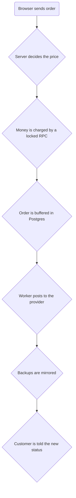
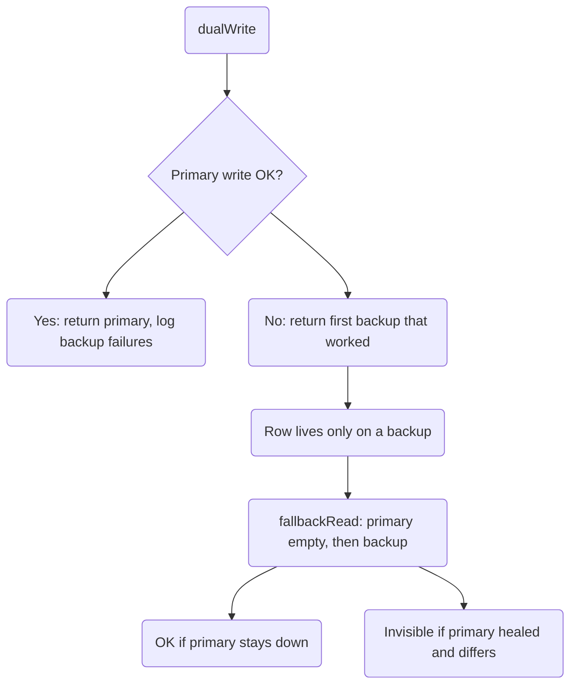

# PinoyBoosting — Deep Study (Part 5: The Trust Chain & What Changed)

> Fifth pass. Parts 1–4 (`project-study.md`, `project-study-ui-and-ai.md`,
> `project-study-part-3.md`, `project-study-part-4.md`) covered money, UI,
> security and the data model. This part does two things the earlier passes did
> not:
>
> 1. **Verifies** their biggest claims against the code as it is *today* and
>    corrects what has drifted.
> 2. **Follows one path end to end** — the "trust chain" that runs from the
>    browser to the customer's money — and names the exact place where each
>    layer stops trusting the one before it.
>
> Every claim below was read from a file in this repo. Counts taken this pass:
> **235** `.ts`/`.tsx` files under `src/`, **77** API route files,
> **29** pages, **14** SQL migrations, **34** scripts.

---

## 0. Verified corrections to Parts 1–4

| Earlier part said | The code today | Verdict |
|---|---|---|
| Part 3 #1 (High): `settings` has no RLS, so the public anon key can read the Telegram bot tokens | **Still true.** No migration contains `ALTER TABLE settings ENABLE ROW LEVEL SECURITY`, and no `CREATE POLICY ... ON settings` exists anywhere. On Supabase, a `public` table with no RLS and default grants is readable by `anon`. | **Open — the top risk** |
| Part 3 #6: the retry cron only sees `status='Processing'` | **Fixed again.** `retry-queued-orders` filters `status=Processing` **and** `external_order_id is null` **and** `external_status ilike 'Queued:%' or 'Failed:%'` **and** a `last_attempt_at` 30-min guard. The queue reason lives in `external_status`, not `status`. | Closed |
| Part 4 #7: emails print `PHP` while the site prints `₱` | **Largely fixed.** `telegram.ts` now prints `₱` in the order/complete/alert templates. A few admin captions still say `PHP`. | Mostly closed |
| Part 3: admin PIN is scrypt + signed expiring cookie + lockout | **True**, and `admin_secrets` uses RLS with **no policy at all**, so only the service role can touch it. | Solid |
| Part 1 #4: `SpyQueryBuilder` mistranslates filters | **True and important.** It implements only `eq`, `order`, `limit`, `single`, `maybeSingle`. There is **no `neq`, no `or`, no `ilike`, no `is`, no `gte`**. | Open |

Two new facts the earlier passes did not record:

- **`SpyQueryBuilder.execute()` runs the DigitalOcean statement and the Supabase
  statement on *every* call, then returns the DigitalOcean result — and on
  failure returns the DigitalOcean *error*, discarding a successful Supabase
  write.** So the translator never returns a backup's success to a caller.
- **`ensureOrdersSchema()` and `hasServiceTitleColumn()` actively `ALTER TABLE`**
  the primary and probe backups at request time. The app self-migrates the
  `service_title` column at checkout.

---

## 1. The trust chain, in one picture

Every request walks the same staircase, and each step decides how much it
believes the step below. This is the single most useful model of the app.



Read it as: **the browser is never trusted, the price is always recomputed, the
money is always locked, the provider is never assumed to work, and the customer
is always told last.** That is a genuinely well-built shape. The rest of this
part is where each step leaks a little trust.

---

## 2. Step 1 — the browser (untrusted by design): **Solid**

`src/app/api/orders/create/route.ts` is the gate, and it checks before it
believes:

- **Auth first.** `auth.getUser()`; no session → 401.
- **Identity match.** It rejects when `body.email !== user.email` (403) — a
  customer cannot order under another account's email.
- **Shape checks.** Quantity must be a positive integer; the target string is
  capped at 7000 chars; wallet payments are refused here and routed to the
  wallet endpoint.
- **Server-side price.** `resolveOrderPricing()` is called with the *server*
  admin client. The browser's `catalogSnapshot` is only a last-resort fallback
  when the live provider catalog is unreachable.

**Leak (Low):** the browser may supply `orderId`. It is accepted only if it
matches a strict UUID regex, otherwise a server UUID is used — so the client can
*name* its own order but cannot inject anything else. Fine, but worth knowing the
tracking ID shown instantly in the UI is client-chosen.

---

## 3. Step 2 — the price: **the markup is applied twice on one path**

The `services` table stores `starting_price` and `price_per_unit`. Those columns
are written when the catalog is synced. `src/lib/smmCatalog.ts` computes them as
**provider rate × markup**:

```ts
const ratePer1k = originalRate * markupMultiplier;
const startingPrice = ratePer1k / 1000;   // already marked up
```

`resolveOrderPricing()` then charges:

```ts
regularAmount = Math.max(finalQuantity * service.startingPrice, MIN_ORDER_AMOUNT);
```

— it multiplies by the **already-marked-up** stored price. Meanwhile the
"All Services" catalog path multiplies the live `startingPrice`, which is *also*
marked up. So both paths are consistent **provided the stored row was written
with the same markup**.

**Leak (Medium):** if an admin later changes the markup multiplier, the live
catalog path re-prices immediately, but the **stored `services` rows keep their
old marked-up price** until a re-sync. The two paths can therefore charge two
different prices for the same thing until someone re-imports. There is no code
that detects this drift.

**Leak (Low):** `isSingleItemService()` decides whether a service's minimum is 1
or the provider minimum by regex-matching the **title**
(`/page|gemini|piso\s*wifi|.../`). A rename silently changes the minimum
quantity a customer can order.

---

## 4. Step 3 — the money: **Solid, with one honest caveat**

Wallet spend goes through `create_wallet_order`, and credits through
`credit_wallet_atomic` / `approve_topup_atomic` — all `SECURITY DEFINER`,
row-locked (`FOR UPDATE`), `search_path` pinned, and granted **only** to
`service_role` (Parts 1 and 4 verified this; still true).

**Caveat (Medium, restated from Part 4):** the same "trust" is *not* applied
everywhere. `src/utils/referrals.ts` credits a referrer with
`balance = read + commission` in JavaScript — a classic lost update, with no
lock. The locked RPC exists; the referral path just does not use it. The daily
check-in (`/api/checkin`) **does** use the locked RPC, and even rolls back its
own row if the credit fails — it is the pattern the referral path should copy.

---

## 5. Step 4 — the buffer: **where the two databases can quietly disagree**

This is the most important new finding of this pass, and it is narrower than
Part 1 implied but sharper than Part 3 corrected.

`dualWrite()` (in `src/utils/supabase/dual-db.ts`) runs a single `operation`
twice: once against DigitalOcean (through the SQL translator) and once against
**every** configured Supabase backup. For a real Postgres/Supabase client both
statements are genuine inserts. But:

- `dualWrite` returns the **primary's** result. If the primary succeeds, the
  caller sees success — even if a backup write failed. Failure is only
  `console.error`-ed.
- If the primary fails, it returns the **first backup that succeeded**. So a
  write can be *reported* as `databaseUsed: "backup"` and live only there.

Reads (`fallbackRead`) try the primary first, then walk the backups **only when
the primary returns `null` or errors**. So the design already anticipates that a
row may live on a backup.

**Why it matters:** if the DigitalOcean primary write fails but a backup accepts
the insert, and a *different* request reads before the primary is repaired, the
reader and writer have seen two different databases. There is **no reconciliation
job** — `scripts/sync-order-mirrors.mjs` exists (untracked in git) but nothing
runs it on a schedule and no migration adds a drift check.

**A second, subtler leak:** `SpyQueryBuilder` ignores any filter it does not
understand. A route that writes `.eq("id", x)` then reads with a richer filter on
the same builder would silently query **all rows**. Today the order-creation path
only uses `eq`, so it is safe — but it is a trap waiting for the next feature
that adds an `.or()` or `.ilike()` to a dual-DB call.



---

## 6. Step 5 — the provider: **Solid, deterministic, but slow to trust**

`src/lib/rixeysmm.ts` (Part 1 §6 and Part 3 §5 already praised the logic) adds
one thing this pass looked at closely: **five separate network races on the hot
path**, each with its own patience.

| Where | Timeout | On timeout |
|---|---|---|
| Live catalog (required lookup) | 16s | throw "temporarily unavailable" |
| Live catalog (soft check) | 1.5s | continue, trust the DB price |
| Stored-catalog fallback select | 8s | throw |
| Provider balance preflight | none (`fetch` default) | continue and try to place |
| Admin profit resolver lookup | 2.5s | cost reads **0**, profit reads **full** |

**Leak (Medium):** the admin "estimated profit" equals the whole amount whenever
the provider is slow, because `resolveSmmServiceCost()` returns 0 on a missed
lookup (Part 2 §2 flagged this; confirmed still true). It is a dashboard number,
not money — but it is the number the owner looks at.

**Leak (Low):** the balance preflight has **no timeout**. A hanging provider
balance call can hold a placement open until the serverless function is killed,
at which point `markPlacementAttempt()` is never reached and the 30-minute retry
guard is skipped.

---

## 7. Step 6 — the backups and the customer: **fire-and-forget everywhere**

Every delivery step after the primary write is a `.catch()`ed promise or an
`after()` task: order events, promo redemption, email, push, Telegram, backup
sync. This is why the app survives a dead email key or a Telegram outage — and
why it can fail **silently** (Part 4 §7 said this; still true). There is no
`settings` "last successful email" stamp and no admin health row.

**New confirmation:** the deferred backup sync is wrapped in Next.js `after()` in
`orders/create`, so the response returns before backups are written. A crash
between the response and the `after()` callback loses that order's backup copy
with only a `console.error`.

---

## 8. Telegram config: three sources, and the one that is a real hole

`src/lib/telegram-config.ts` resolves the bot token in this order:

1. **Env vars** (`TELEGRAM_ORDER_BOT_TOKEN` / `_TOPUP_...`).
2. **Supabase Storage** — a JSON file at `receipts/admin-config/telegram.png`
   and `.../telegram-topup.png` in the **primary** project.
3. The same files in each **backup** project.

Then `src/lib/telegram.ts` falls back to `settings.telegram_order_config` /
`telegram_topup_config` (the rows Part 3 flagged as exposed).

**Finding (High, ties to §0):** the tokens therefore live in **three places** —
env, a JSON file inside the `receipts` bucket, and the un-RLS'd `settings` rows.
The bucket is created `public = true` with a `TO public` SELECT policy in
`20260612000000_create_receipts_bucket.sql`, and — unlike uploads, which are
hash-named — the config file sits at a **fixed, guessable path**
(`admin-config/telegram.png`). So the bot token was reachable at a predictable
public URL as well as through `settings`. Hardening only one of the three leaves
the others open. A leaked token lets a stranger read the approval chat and, with
the webhook secret, impersonate approvals.

---

## 9. Where the AI touches money

Three money-adjacent AI touch points, all bounded:

- **Receipt vision** (`receiptVerifier.ts`) can flip an order to `Processing`
  automatically, but only when *all* the gates pass: `isPaymentReceipt === true`,
  currency PHP, confidence ≥ 0.7, not AI-generated, tamper score < 70, amount
  matches, **receiver matched to the approved destination**, and a **unique**
  reference number. A failure falls through to a human. This is the strongest
  AI-money gate in the app.
- **Chatbot** (`/api/chat`) quotes prices from the **live catalog**, never from
  the model, and refuses to quote when the catalog is down (Part 2 §3 — true).
- **`/api/ai-search`** still bypasses the hardened provider chain and calls a
  free third-party endpoint directly (Part 3 §6 — still true).

---

## 10. Coverage today (fresh)

`vitest` covers **five** pure files: `orderPricing`, `promo`, `receiptGuard`,
`fbReactions`, `vip`. Still untested: the four money RPCs, every order route,
the whole `dual-db` layer, `referrals`, `checkin`, `chatOffers`,
`referral-program`, and `smmCatalog`. The cheapest high-value additions are the
pure ones — `chatOffers.ts` and `referral-program.ts` have no I/O.

---

## 11. Consolidated risk register (this pass)

| # | Priority | Finding | Fix |
|---|---|---|---|
| 1 | **High** | Telegram tokens live in un-RLS'd `settings` **and** a public receipt bucket **and** env | Move tokens to `admin_secrets`; make the config files a private bucket |
| 2 | **High** | A dual-write can land only on a backup, with no reconciliation | Reconcile job + make a primary-down write fail loudly |
| 3 | Medium | `SpyQueryBuilder` silently ignores filters it does not implement | Implement `neq/or/ilike/is`, or assert-fail on unknown filter |
| 4 | Medium | Stored `services` prices can drift from the live markup | Re-price on markup change, or document the sync step |
| 5 | Medium | Referral credit is read-then-write, not locked | Move onto `credit_wallet_atomic` |
| 6 | Medium | Provider balance preflight has no timeout | Add an `AbortSignal.timeout` |
| 7 | Low | Profit reads full amount when the provider is slow | Show a dash, not 100%, on a missed lookup |
| 8 | Low | `isSingleItemService` infers the minimum from the title | Add an explicit `is_single_item` flag |
| 9 | Low | Deferred backup sync can be lost on crash | Health stamp in `settings` + admin row |

---

## 12. What to do next (one thing)

If only one thing is done: **close the Telegram-token hole (#1).** It is the only
finding that is both exploitable today with a key that already ships to the
browser, and small to fix — move both `telegram_*_config` rows into
`admin_secrets` (the pattern already exists for the PIN), point the storage
reader at a **private** bucket, and delete the config files from `receipts`.

---

## 13. One-line summary

Parts 1–4 mapped the **engine, the dashboard, the perimeter and the skeleton**.
Part 5 adds the **trust chain**: the browser is untrusted, the price is
recomputed, the money is locked — all genuinely strong — while the two remaining
leaks are a **`settings` table that was never given RLS** (so the Telegram tokens
are readable with the public browser key) and a **dual-write that can quietly
land on a backup with nothing to reconcile it**.
