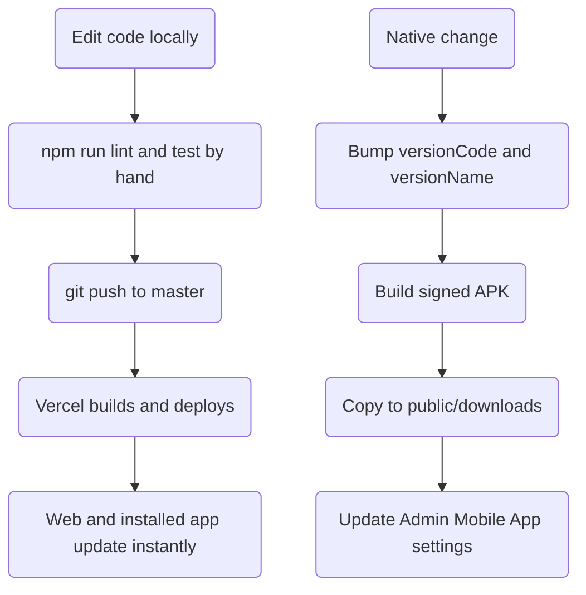

# PinoyBoosting — Deep Study (Part 6: Operations, Repo Hygiene & Release Pipeline)

> Sixth pass. Parts 1–5 covered the money engine, the UI/AI, the security
> perimeter, the data model and the "trust chain". Every one of those looked at
> the **application**.
>
> This part looks at everything *around* the application — the things an agent
> or a new developer trips over first: **where the code ends and the machine's
> own state begins**, the **34 operational scripts**, the **deploy and runtime
> config**, the **Next.js 16 breakage that is already handled**, and the
> **mobile release pipeline**. Every claim below was read from a file in this
> repo or listed from disk.

---

## 0. The one-sentence finding

The application is carefully engineered, but the **working folder is not
separated from the machine**: a full browser profile, three AI-agent state
folders and a video-production workspace all sit inside the project tree, are
**not** ignored by git, and would be published by a single `git add -A`.

---

## 1. The repo has two lives: source code and machine state

`git status` shows what git *tracks*; a directory listing shows what is
*actually there*. The gap between them is the story of this pass.

| Path | What it really is | In `.gitignore`? |
|---|---|---|
| `src/`, `supabase/`, `android/` | The product | tracked |
| `.hormachuelos/` | **A Chromium/Edge browser user-data profile** plus promo screenshots and an mp4 | **No** |
| `.swarm/` | AI-agent swarm state (`state.json`, `memory.db`, `schema.sql`) | **No** |
| `.claude/`, `.claude-flow/` | Agent tooling: memory db, swarm activity, codebase map, learning state | **No** |
| `promo-video/` | A whole video workspace: `render-video.mjs`, `scene.html`, music, voiceover, extracted frames, ad mp4 | **No** |
| `rixeysmm_best.json`, `rixeysmm_services.json` | Raw supplier catalog dumps, sitting in the repo root | **No** |
| `.mcp.json` | MCP server config for agent tooling | No (`autoStart: false`) |

**Finding — Medium (repo hygiene, privacy).** `.hormachuelos/` is not a normal
folder. Its contents include `Cookies`, `Login Data`, `Web Data`, `History`,
`Vpn Tokens` and `Local State` — the standard file names of a **Chromium browser
profile**, i.e. saved logins and session cookies. At the time of this pass it is
**untracked** (`??` in `git status`), so nothing has leaked *yet*. But because
none of these paths is in `.gitignore`, a routine `git add -A && git commit`
would push a browser profile — cookies and all — to the remote.

**Fix (small):** add these lines to `.gitignore` before the next commit:

```gitignore
# agent + machine state, never commit
.hormachuelos/
.swarm/
.claude/
.claude-flow/
promo-video/
rixeysmm_*.json
```

Then decide deliberately whether `promo-video/` (a real asset source) and the
catalog dumps should be kept somewhere outside the repo instead.

---

## 2. The scripts folder: 34 one-off ops tools, no runner

`scripts/` holds **34** `.mjs`/`.js` files. `scripts/README.md` documents the
naming convention, which is genuinely helpful:

| Prefix | Meaning |
|---|---|
| `backfill-*` | data backfills over existing rows |
| `create-*` | schema or record creation |
| `setup-*` | environment / settings setup |
| `update-*` | bulk updates of services, prices, captions |
| `import-*` / `export-*` | data portability |
| `run-*` | infra helpers |

Three of them carry real operational weight and are worth knowing by name:

- **`run-migration.mjs`** — applies a SQL file to the **DigitalOcean primary and
  every configured Supabase backup**. This is the manual, multi-database
  migration runner that Parts 1/3/5 flagged as a risk. Files are written
  idempotently (`IF NOT EXISTS`), so re-runs are safe — but **nothing stops a
  half-applied migration** if the primary succeeds and one backup fails.
- **`sync-order-mirrors.mjs`** — the **only reconciliation tool** in the project.
  It copies `status`, `external_order_id`, `external_status` and `smm_service_id`
  from the primary to the master and the backups, for a **single** order given by
  id or `BS-XXXXXXXX` short code. It exits `0` clean, `1` bad input, `2` partial
  failure. It is **run by hand** — no cron, no schedule. This is the manual
  answer to the "dual-write can land on a backup" risk from Part 5.
- **`load-test-signup.mjs`** — a concurrency tester for the signup endpoint, with
  two modes (`next` route, or Supabase `auth/v1/signup` directly). **It creates
  real, unconfirmed auth users** and says so in its header warning. It reads its
  key from `SIGNUP_ANON_KEY` in the environment and never prints it — correct.

**Finding — Low (no runner).** There is no `package.json` script that runs
`sync-order-mirrors` or a "migrate all databases" task in one safe step. The two
highest-risk ops jobs are remembered commands, not code. As the app grows, this
is where a mistake happens at 2am.

---

## 3. Deploy and runtime configuration

Three places shape how the app runs in production, and each has a story.

### 3.1 `vercel.json` — three crons

```json
"crons": [
  { "path": "/api/cron/cleanup-orders",     "schedule": "0 3 * * *"  },
  { "path": "/api/cron/check-balances",     "schedule": "0 9 * * *"  },
  { "path": "/api/cron/retry-queued-orders","schedule": "30 2 * * *" }
]
```

It also declares `pinoyboosting.com` and `www.pinoyboosting.com`. Note that the
crons are declared **here, not in code** — change a schedule in the dashboard and
`vercel.json` no longer describes reality. Worth a comment in the file.

### 3.2 `next.config.ts` — two defensive choices

- **`turbopack.root` is pinned to `process.cwd()`.** The comment explains why: a
  stray `package-lock.json` in the *user's home directory* once made Next.js
  infer the wrong workspace root. This is the scar of a real local-dev incident.
- **Env values are cleaned at build time** (`cleanEnvValue()` strips zero-width
  and BOM characters) before being inlined as `NEXT_PUBLIC_*`. So the invisible-
  character bug that Parts 1/3/5 mention is defended **in three layers**: here,
  in `src/instrumentation.ts`, and in `src/utils/env.ts`.

### 3.3 `src/proxy.ts` — the whole request gate (Next.js 16 renamed Middleware → Proxy)

`proxy.ts` runs on every request except static assets, and it does four things in
a deliberate order:

1. **Security headers** on every response — `X-Frame-Options: DENY`, `nosniff`,
   `Referrer-Policy`, `Permissions-Policy` (camera/mic/geo off), COOP, CORP and
   HSTS. Strong baseline.
2. **Maintenance-mode probe** against the `settings` table, with a 3-second
   abort. A list of paths **bypasses** it (admin, auth, chat, orders, checkout,
   receipts) so a maintenance toggle never blocks an order already in flight.
   This is thoughtful.
3. **Fail-closed vs fail-open.** If the Supabase client cannot be built at all
   (bad env), admin areas return **503** while public pages keep serving. Parts 3
   and 5 already praised this; confirmed still true.
4. **Admin authorization** by `isAdminEmail()` for `/admin` and `/api/admin/*`.

**Finding — Low (CORS is wide open on APIs).** Every `/api/*` response gets
`Access-Control-Allow-Origin: *`. For a cookie/JSON app this is mostly harmless
because auth is Bearer-header based, but it does let any website call the public
APIs from a browser. Locking it to the project's own origins would be tighter.

---

## 4. Next.js 16: the breaking changes that are already handled

The project runs **Next.js 16.2.6** with React 19, and `AGENTS.md` warns that the
conventions differ from older Next.js. Two of those differences are already
handled in this code:

| Next 16 change | How this repo handles it |
|---|---|
| Middleware is renamed to **Proxy** | `src/middleware.ts` was migrated to **`src/proxy.ts`** (see `docs/conversation-notes-2026-07.md`). The exported function is named `proxy`. |
| **Turbopack** is the default | `next.config.ts` sets `turbopack.root` explicitly. |
| `after()` for post-response work | Used in `orders/create` to defer backup sync and notifications (Parts 4/5). |
| Local docs authority | `node_modules/next/dist/docs/` is present and is what `AGENTS.md` points agents to. |

There is **no CI**. `.github/` does not exist, so **nothing blocks a bad commit**:
no automatic `npm run lint`, no `npm test`, no build check on push. `vitest`
covers five pure files (Parts 4/5); the money RPCs, order routes and the whole
dual-db layer have no automated cover, and no pipeline runs even the five.

**Finding — Medium (no safety net).** A one-file GitHub Actions workflow running
`npm ci && npm run lint && npm test && npm run build` on every push is the single
cheapest way to stop a regression reaching production. The scripts to do it
already exist in `package.json`.

---

## 5. The mobile release pipeline

The Android/iOS clients are **Capacitor shells pointed at the live website**, and
every config value agrees on that:

| Piece | Value |
|---|---|
| `capacitor.config.ts` | `appId: com.pinoyboosting.app`, `server.url: https://pinoyboosting.com/app` |
| `webDir` | `android-shell/` — which holds only `index.html` and `offline.html` |
| `appendUserAgent` | `PinoyBoostingClientApp` (+ per-platform suffix when running in a browser) |
| `android/app/build.gradle` | `versionCode 2`, `versionName "2.0"` |
| Committed APK | `public/downloads/pinoyboosting.apk` (~3 MB, the release-signed build) |

**Why the webview flag matters:** because `server.url` is set, the shell loads the
live site, so a **web change ships instantly** to every installed app; only
**native** changes need a new APK. That is the design in `MOBILE_CLIENT_APP.md`,
and `appendUserAgent` is how the site knows it is inside the app (to serve the
light `/app` route and to offer the Update button).

**Finding — Medium (version drift).** The published app version now lives in
**three** places that must be moved together, with nothing keeping them in sync:

1. `android/app/build.gradle` → `versionCode` / `versionName` (**currently 2 /
   "2.0"**)
2. the **Admin → Mobile App** settings row (what the download page advertises)
3. `public/downloads/pinoyboosting.apk` (the file actually downloaded)

If someone rebuilds the APK but forgets the admin setting, the site advertises a
version the file is not. `MOBILE_CLIENT_APP.md` warns about this in prose; a
script that reads `versionName` from `build.gradle` and checks it against the
`mobile_app_settings` row would catch it automatically.

**Good:** the signing material is correctly kept out of git — `*.jks`,
`*.keystore` and `android/keystore.properties` are all in `.gitignore`, and debug
APKs are blocked from `public/downloads/`. The release keystore fingerprints in
`MOBILE_CLIENT_APP.md` are documented for reference (safe — fingerprints are
public, the keystore itself is not).

---

## 6. How a change reaches a customer today



Every box after the first is a **manual step**. The web path is fast because
Vercel deploys on push; the native path is where the three version sources can
drift.

---

## 7. Consolidated risk register (this pass)

| # | Priority | Finding | Fix |
|---|---|---|---|
| 1 | **Medium** | `.hormachuelos/` browser profile (Cookies, Login Data) sits in the project tree and is **not** gitignored | Add it (and the other agent/video folders) to `.gitignore` |
| 2 | **Medium** | No CI — nothing runs lint, tests or build on push | One GitHub Actions workflow |
| 3 | **Medium** | App version in three unsynced places | Script that compares `build.gradle` with `mobile_app_settings` |
| 4 | Medium | `run-migration.mjs` is manual and not atomic across 5 databases | A migration ledger table + a fail-loud runner |
| 5 | Medium | `sync-order-mirrors.mjs` is the only reconciliation and is run by hand | Schedule it, or a drift report in the admin |
| 6 | Low | `promo-video/` (renders, frames, mp4) and root catalog JSON are unignored repo bloat | Ignore or relocate |
| 7 | Low | CORS `Access-Control-Allow-Origin: *` on all `/api/*` | Restrict to own origins |
| 8 | Low | Cron schedules live in `vercel.json`, not code | Comment the file, or document the dashboard as source of truth |
| 9 | Low | `README.md` is still the default `create-next-app` template | Point it at the study docs |

---

## 8. What is genuinely well built (this pass)

- **Env cleaning at three independent layers** (`next.config.ts`,
  `instrumentation.ts`, `utils/env.ts`) — the invisible-character bug cannot
  survive any single layer being bypassed.
- **The proxy's maintenance bypass list** is a real product decision, not a
  checkbox: order and auth paths keep working while the site is "down".
- **Fail-closed admin / fail-open public** in the proxy, verified in code.
- **`scripts/README.md`** names every script convention, so the folder is
  navigable rather than a pile.
- **The load-test and the keystore are both handled with care** — one refuses to
  print its key, the other is kept out of git with a documented backup warning.
- **Next.js 16's two biggest breaking changes** (middleware→proxy, Turbopack
  default) are already migrated.

---

## 9. One-line summary

Parts 1–5 map the **engine, the dashboard, the perimeter, the skeleton and the
trust chain** — all inside `src/`. Part 6 steps back and shows the **edge of the
project**: a well-configured deploy that fails safe, a capable but entirely
manual ops toolbox, a mobile pipeline with three version sources that can drift
— and a working folder that has quietly collected a **browser profile, three
agent-state folders and a video studio**, none of them ignored by git.
