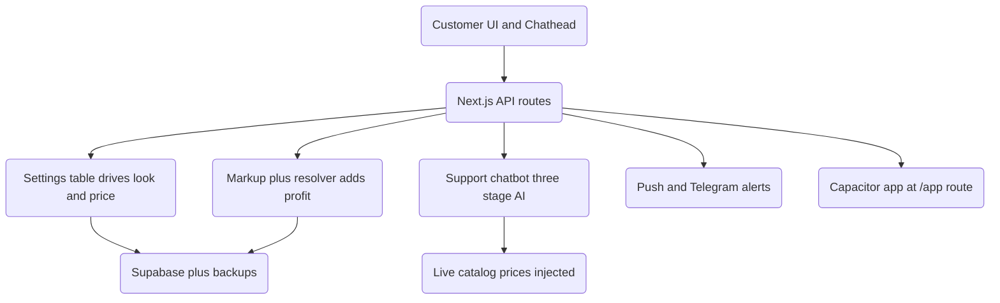

# PinoyBoosting — Deep Study (Part 2: UI, Admin, AI & Delivery)

> Companion to `docs/project-study.md` (money + data + supplier layers).
> This part covers the layers not studied before: the customer UI, the admin
> workspace, the support chatbot, mobile delivery, and the "profit resolver".

---

## 1. The setting that runs everything: `settings` table

Almost every "configurable" thing in this app is **not** a constant in code — it
is a row in the Supabase `settings` key/value table, read at request time.

The admin panel is essentially a **front end for that table**. Each panel writes
one key:

| Admin panel | What it controls |
|---|---|
| `HeroTextSettingsPanel` | Homepage headline + copy |
| `HeroVideoSettingsPanel` | Hero background video |
| `ShowcaseVideoSettingsPanel` | Showcase / promo video |
| `MarkupSettingsPanel` | **Price markup over provider cost** |
| `AnnouncementSettingsPanel` | Site-wide announcement modal |
| `MaintenanceSettingsPanel` | Maintenance mode toggle |
| `ServicesBgSettingsPanel` | Services section background |
| `WidgetVisibilityPanel` | Which floating widgets show |
| `CustomerAlertsSettingsPanel` | Customer alert banners |
| `TelegramSettingsPanel` | Telegram bot + approval routing |
| `CleanupSettingsPanel` | Data retention / cleanup rules |
| `StorageOptimizingPanel` | Storage housekeeping |

**Why it matters:** the site's look and pricing can change **without a deploy**.
But it also means the DB is the source of truth for behavior — if a settings row
is wrong or missing, the site changes with no code diff to explain it.

---

## 2. The profit engine (markup + resolver)

This is the commercial heart of the panel.

- **`MarkupSettingsPanel`** sets the multiplier/percentage added on top of the
  supplier's raw rate.
- **`src/lib/smmServiceResolver.ts`** turns a raw order into money numbers:
  - `resolveSmmServiceTitle()` → human title from the supplier's service name.
  - `resolveSmmServiceCost()` → `quantity / 1000 * supplierRate`.
  - `enrichOrdersWithResolvedServiceTitles()` → adds `estimated_provider_cost`
    and **`estimated_profit`** (customer amount − provider cost) to each order.

So the admin Orders page shows **real profit per order**, computed live.

**Two costs to know about:**
- The resolver cache lives **5 minutes**, and the supplier lookup has a **2.5s
  timeout**. If the supplier is slow (cold start is 8–12s), the title falls back
  and the cost reads **0** — so "estimated profit" can briefly equal the full
  amount. It is an *estimate*, not accounting truth.

---

## 3. The support chatbot (`api/chat`)

A surprisingly layered feature, not a single API call.

**Flow:**
1. Sanitize messages; keep the last 8 turns.
2. Detect a **price question** → fetch the **live SERVICES catalog** (5s race
   timeout) and inject real prices as ground truth.
3. Build one system prompt (tone: warm Taglish/Bisaya, 1–3 emojis, never invent
   a price).
4. Try a **three-stage AI fallback chain** (primary → secondary → last-resort),
   each guarded by a shared time budget.
5. If every stage fails → **deterministic answers**: a real price list from the
   catalog, or a keyword-based support reply.

**Notable details:**
- The whole route has a **52s budget** and `maxDuration = 60`, so it can never
  overrun serverless limits. A minimum of 8s must be left before trying the next
  stage — otherwise it skips ahead.
- A **hardcoded creator answer**: any "who made this" question returns the
  owner's name and Facebook link. Do not let a model invent a creator.
- The system prompt carries **live payment details** (GCash + BPI). These are
  customer-facing, but they live in code + are sent to a third-party AI — worth
  knowing.
- Fallbacks deliberately **refuse to quote a price** when the catalog is down,
  so a stale guess never disagrees with the website.

---

## 4. Push notifications

- Web Push with **VAPID** keys (`api/push/vapid-public-key`).
- Subscriptions saved per **`endpoint`** (unique), tied to a logged-in user.
- Every subscription is also **synced to the backup databases** (`dual-db`).
- Endpoints: `subscribe`, `unsubscribe`, `vapid-public-key`.

---

## 5. Mobile delivery

- The APK is a **Capacitor shell** pointed at the live site.
- A **light route at `/app`** (`ClientAppHome`, plus `orders`, `profile`,
  `auth`) skips hero video, floating widgets and heavy effects for the WebView.
- The signed APK is served from `public/downloads/pinoyboosting.apk`.
- `ClientAppUpdateButton` + `mobile-app-settings` API let the shell prompt for
  updates.

---

## 6. Front-end shape

- **29 components** in `src/components`: Header/Footer, Hero search + video,
  ServiceCard/ServicesSection, OrderModal, TopUpModal, PriceCalculator, Chathead
  (floating chat), LinkPreviewWindow, LiveOrderTicker, StatCounters, theme
  toggle, PWA register, cursor/fX effects.
- **Design language:** dark, Spotify-green (`#1DB954`) accent, rounded cards,
  `animate-in fade-in`, heavy uppercase micro-labels.
- **Admin shell:** grouped sidebar (Operations / Catalog / Customers), a 5-tab
  bottom nav on mobile, PIN gate, and a security panel.

---

## 7. How the layers connect

---

## 8. Health notes (this pass)

| Priority | Finding | Why it matters |
|---|---|---|
| **Medium** | Profit numbers rely on a 5-min cache + 2.5s supplier timeout | Shows **full amount as profit** when the supplier is slow |
| **Medium** | Site behavior depends on `settings` rows | A bad row changes the site with **no code change to trace** |
| **Medium** | Chat sends **live payment details** to a third-party AI | Leak/abuse surface you cannot fully control |
| **Low** | Three-stage AI chain with silent failures | Hard to tell **which stage answered**; only `console.warn` |
| **Low** | Creator answer is hardcoded | Intentional guard — keep it |

---

## 9. One-line summary

Part 1 showed a **locked-down money engine**. Part 2 shows a **database-driven
app** where the admin panel, the pricing markup, the chatbot and the mobile shell
all read from the same settings + catalog source — flexible, but it means the
database, not the code, decides what customers see and pay.
