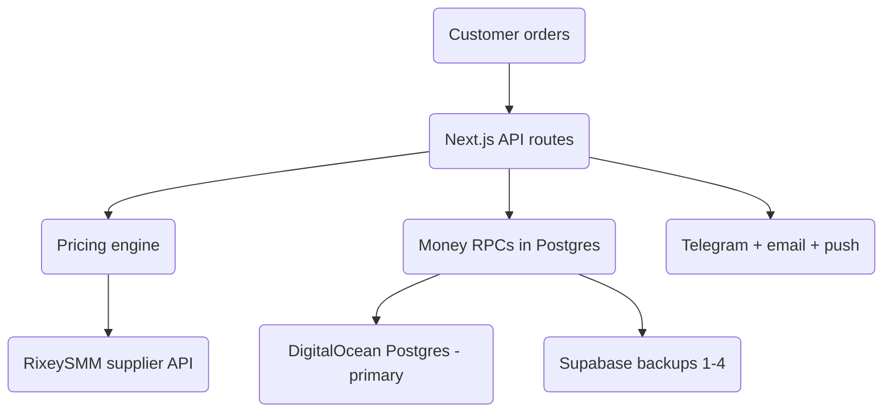

# PINOYBOOSTING — Deep Study

An architecture and risk study of the codebase, based on reading the source files
directly. Sections marked **Solid** are things the code already does well.
Sections marked **Risk** are structural weak points worth planning around.

---

## 1. The big picture

PinoyBoosting is an SMM panel (social media marketing store) for a Philippine
audience. Customers buy likes, followers, views and related boosts. Orders are
fulfilled by an outside supplier, **RixeySMM**, and paid for by GCash/BPI receipt
or prepaid wallet balance.

The surprising part is underneath: **the app does not talk to one database.**
It talks to a DigitalOcean PostgreSQL database as the *primary*, plus up to four
Supabase projects as *backups*, through a custom translation layer in
`src/utils/supabase/dual-db.ts`.



---

## 2. Stack (verified from files)

| Layer | Technology |
|---|---|
| Web | Next.js 16, React 19, Tailwind 4 |
| Primary DB | DigitalOcean PostgreSQL (via `postgres` npm driver) |
| Backups | Supabase ×4 projects (`BACKUP`, `BACKUP3`, `BACKUP4`, `BACKUP5`) |
| Auth | Supabase Auth |
| Supplier | RixeySMM `api/v2` (form-encoded POST) |
| AI | OpenAI-compatible client: CommandCode primary, OpenRouter fallback |
| Mobile | Capacitor shell → loads the live site |
| Hosting | Vercel + 3 daily cron jobs |

---

## 3. Money path

### 3.1 Atomic Postgres functions — **Solid**

All balance changes go through `SECURITY DEFINER` PL/pgSQL functions that take a
row lock (`FOR UPDATE`), validate, then change the balance and the record in one
transaction:

| Function | Purpose |
|---|---|
| `create_wallet_order` | Deducts wallet, creates/updates the order |
| `approve_topup_atomic` | Credits a top-up, marks it approved |
| `credit_wallet_atomic` | Generic credit (refunds, check-in rewards) |
| `activate_vip_wallet_atomic` | Pays for a VIP plan from the wallet |

Each one is locked down correctly:

```sql
REVOKE ALL ON FUNCTION create_wallet_order(...) FROM PUBLIC, anon, authenticated;
GRANT EXECUTE ON FUNCTION create_wallet_order(...) TO service_role;
```

And each pins `SET search_path = public`, which closes the classic
`SECURITY DEFINER` search-path hole. This is the strongest part of the codebase.

### 3.2 Pricing — **Solid, with one sharp edge**

Pricing is **always recalculated on the server** in `src/lib/orderPricing.ts`.
The browser sends a `catalogSnapshot` that is only used as a last resort if the
live supplier catalog cannot be reached. Pricing order:

1. Look up the service (live Rixey catalog → stored Supabase catalog → client snapshot).
2. Get the raw rate, multiply by the **markup multiplier** (default `3.0`, stored in `settings`).
3. Apply the **VIP discount** (10 / 15 / 20%).
4. Apply the **promo code** on top.
5. Floor at ₱5 minimum order.

**Sharp edge:** the RixeySMM catalog fetch takes **8–12 seconds** on a cold
serverless start (timeout raised to 15–16s). Soft availability checks use a
1.5s race so checkout is not blocked — meaning an order can be accepted for a
service the supplier no longer lists, and only fail at placement.

---

## 4. The dual-database layer — **Biggest Risk**

`src/utils/supabase/dual-db.ts` contains a class called `SpyQueryBuilder` that
reimplements the Supabase JS query builder so the same code can run against a
raw PostgreSQL connection.

**How it behaves:**

- `dualWrite()` writes to DigitalOcean **first**, then every configured Supabase backup.
- If the DigitalOcean write fails, the first successful **backup** is used.
- `fallbackRead()` reads DigitalOcean first; only if it errors or returns
  nothing does it try the backups.

**Risks this creates:**

1. **Split brain.** If a DigitalOcean write fails and a backup accepts it, the
   order exists only on a backup. Because reads try DigitalOcean first, a later
   read may not see that order.
2. **Partial SQL support.** `SpyQueryBuilder` only implements `eq`, `order`,
   `limit`, `single` and `maybeSingle`. Filters like `.neq()`, `.or()`,
   `.ilike()`, `.is()` or `.lte()` are **not** translated. It also hand-maps
   `services(title)` to a `service_title` column. Any route that needs a richer
   filter cannot safely use the dual path.
3. **Two parallel styles.** Some routes use `dualWrite`/`fallbackRead`, others
   call Supabase directly (`orders/create` uses `dualWrite`, but the cron jobs
   use a plain `createClient`). The two paths can disagree.
4. **No reconciliation.** There is nothing that compares databases and repairs
   drift.

**Recommendation:** pick one source of truth. If DigitalOcean is primary, make
every write fail loudly when the primary is down rather than silently landing
in a backup.

---

## 5. Migrations vs. multiple databases — **Risk**

`supabase/migrations/` holds 14 SQL files, but the primary database is
DigitalOcean. Each migration must be applied **manually to the DigitalOcean
database plus every Supabase backup**. There is no automated runner and no
schema-version table.

The code already shows the scar tissue: `orders/create` and `checkout-wallet`
contain defensive fallbacks named `looksLikeMissingVipSchema` and
`looksLikeMissingServiceTitle`, which retry the insert without the newer columns
when a database is behind. That is a good safety net, but it also proves the
databases have drifted before.

---

## 6. Supplier pipeline (`src/lib/rixeysmm.ts`) — **Solid logic**

Order placement does a lot right:

1. Resolves the Rixey service ID from the order, or from the service's JSON description.
2. If the service has no supplier ID, it **stops** — manual services are never forwarded.
3. **Preflight balance check.** If the Rixey balance is ≤ 0, the order is marked
   `Queued:` instead of being sent and failing.
4. **Link uniquification.** It appends `?t=<timestamp>_<random>` to the target URL
   so the supplier's "duplicate link" rule never rejects a repeat order.
5. On success: saves `external_order_id`, sets supplier status to `Pending`.
6. On a funding error: queues the order with a retry timestamp.
7. Any other error: records `Failed: <reason>`.

**Worth knowing:** step 4 changes the link the supplier sees. For platforms that
validate links strictly, the extra query parameter is the kind of thing that can
cause intermittent rejections — it is a deliberate trade-off, not a bug.

---

## 7. Receipt verification — **Solid**

`src/lib/receiptGuard.ts` hashes the uploaded file (SHA-256) and blocks a
receipt only if an **active** prior record uses the same hash. Records with a
status of `rejected`, `cancelled`, `failed`, `declined` or `voided` do **not**
block reuse — so a rejected attempt never traps the customer's real GCash proof.

An AI vision model then reads the receipt and can auto-approve it. Anything
unclear falls through to admin/Telegram review.

---

## 8. Scheduled jobs

| Cron | Schedule (UTC) | Job |
|---|---|---|
| `/api/cron/retry-queued-orders` | 02:30 daily | Re-send orders stuck in `Queued:`/`Failed:` |
| `/api/cron/cleanup-orders` | 03:00 daily | Cleanup |
| `/api/cron/check-balances` | 09:00 daily | Email customers with low wallet balance |

All three require `Authorization: Bearer ${CRON_SECRET}` and fail closed with a
503 when the secret is missing. The retry job guards each order with
`last_attempt_at` so it never hits the supplier more than once per 30 minutes.

**Gap:** the retry job only retries orders whose status is `Processing`. A paid
order that somehow ended up in another status with no `external_order_id` will
not be retried.

---

## 9. What is genuinely well built

- **Server-side pricing** with a client snapshot as fallback only.
- **Atomic, locked, correctly granted** money functions.
- **Refunds return to wallet, never to the bank** — no outbound cash risk.
- **Receipt hashing + AI verification + human fallback**, with the inactive-status rule.
- **Provider balance preflight + queue + retry** instead of silent failure.
- **Fail-closed crons** and rate limits on the order endpoints.
- **Defensive env parsing** (`src/utils/env.ts`) that strips invisible characters
  and stray `KEY=value` prefixes — clearly the result of a past production incident.

---

## 10. Where to look next

| Priority | Item | Why |
|---|---|---|
| High | Dual-DB split-brain | Data can land in a backup and be invisible to reads |
| High | Manual multi-DB migrations | Drift already caused defensive fallbacks in code |
| Medium | In-memory rate limiting | On serverless each instance has its own counter |
| Medium | Supplier cold-start 8–12s | Bedrock limit on checkout latency at scale |
| Medium | No tests for money RPCs | `vitest` covers pricing/promo/receipt/VIP only |
| Low | `payouts` table | Present in the schema; unclear if any code uses it |
| Low | Docs | No architecture doc existed before this one |

---

## 11. Test coverage today

`vitest` files found:

- `src/lib/orderPricing.test.ts`
- `src/lib/promo.test.ts`
- `src/lib/receiptGuard.test.ts`
- `src/utils/fbReactions.test.ts`
- `src/utils/vip.test.ts`

The four money RPCs, the order routes and the whole dual-database layer have no
tests. Those are the highest-value places to add them.
