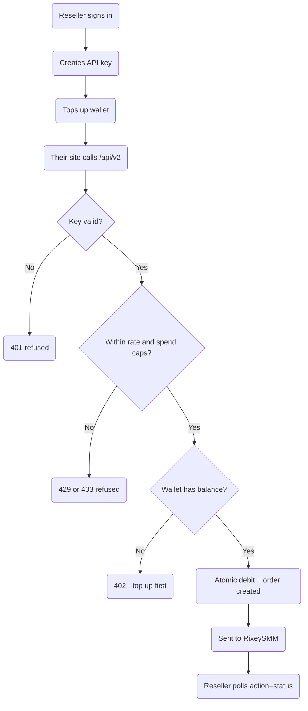

# Reseller API — Build Plan

**Status:** steps 1–5 and 7 BUILT and tested (33/33 checks passing) on 2026-10-13.
Migration applied to the DigitalOcean master and the Supabase primary. Step 6
(database-backed rate limits) is included. Step 8 (deploy) not done yet.

**Created:** 2026-10-13.

## Goal

Let any reseller sign in to pinoyboosting.com, create an API key, and sell your
services from their own website — placing orders through a public HTTP API that
debits their wallet.

The site already advertises this (`src/components/HeroSearch.tsx` line 391:
*"Reseller API access to 1,100+ bulk boosts"*). This plan builds what the copy
promises.

---

## What was built (2026-10-13)

| Piece | File |
|---|---|
| Key helpers (generate, hash, parse, IP allowlist) | `src/lib/apiKeys.ts` |
| The API — services / balance / add / status / refill | `src/app/api/v2/route.ts` |
| Key management (list, create, revoke) | `src/app/api/api-keys/route.ts` |
| API Access page | `src/app/app/api-access/page.tsx` |
| Public docs page | `src/app/api-docs/page.tsx` |
| Admin panel | `src/app/admin/(dashboard)/ResellerApiPanel.tsx` |
| Admin data route | `src/app/api/admin/reseller-keys/route.ts` |
| Migration (tables + 2 atomic RPCs) | `supabase/migrations/20261001000000_add_reseller_api.sql` |

### Test results (33 checks, all passing)

Auth (no key / bad key / revoked), balance, catalog, ordering, insufficient
balance, missing fields, unknown service, **idempotency** (replay returns the
same order and does NOT charge twice), status (single + multi + cross-key
isolation), spend caps, rate limiting, and unknown actions.

### Two real bugs the test caught and fixed

1. **`profiles.currency` does not exist** — the balance action selected a column
   that isn't in the schema, so every balance call returned 500. Now selects
   only `balance` and reports the currency as a literal.
2. **Stale balance written to the mirror.** The backup sync reused the balance
   value captured at request time. Two API orders landing close together meant a
   delayed sync could write an older number over a newer debit on the mirror.
   Both `add` and `refill` now re-read the balance before syncing.

### Note: the test placed REAL provider orders

The end-to-end test calls the real `add` action, which forwards to RixeySMM. Six
test orders were placed at the provider (external IDs 85120–85125) against
`example.com` URLs. They were removed from our database afterwards, but the
provider-side orders exist and will simply fail (the target is not a real page).

**Before running this test again**, be aware it costs a small amount at the
provider and creates provider-side orders. The database rows are cleaned up
automatically.

### A pre-existing issue the log surfaced (not from this feature)

`order_events` inserts fail on the DigitalOcean master with a foreign-key
violation (`order_events_order_id_fkey`). Separately, the Supabase mirror
rejects `last_attempt_at` with a schema-cache error. Both predate the reseller
API and do not block it — worth a look separately.

---

## What already exists (reuse, do not rebuild)

| Piece | Where | Why it matters |
|---|---|---|
| Atomic wallet debit + order create | `create_wallet_order` RPC | Locks the profile row, so a double-call can never double-charge |
| Server-side pricing | `src/lib/orderPricing.ts` | Never trusts a client-supplied price |
| Provider placement | `src/lib/rixeysmm.ts` → `autoPlaceRixeyOrder` | Sends the order to RixeySMM |
| Wallet top-up | `/api/paymongo/*` | Resellers fund their wallet exactly like customers |
| Secret storage pattern | `admin_secrets` migration | RLS on, **zero policies** — service-role only |
| Backup mirroring | `dualWrite`, `syncBackupAdminClients` | Keeps DigitalOcean master + mirrors in sync |
| Order timeline | `recordOrderEvent` | Gives resellers a status history |
| Referral commission | `creditReferralCommission` | Already fires on order completion |

**The whole money path is done.** The reseller API is a new front door onto it,
not a new engine.

---

## Gap to close first

**The existing rate limiter is not safe for a public API.**

`src/utils/security/rate-limit.ts` keeps counts in an in-memory `Map`. On
Vercel that means:

- Every cold start **resets** the counter.
- Each serverless instance has its **own** memory, so 5 instances allow 5x the limit.
- It keys on **IP**, which a reseller can rotate freely.

A public API needs limits stored in the **database**, keyed by **API key**.
This is step 6 below and is not optional.

---

## Architecture

---

## Data model

Two new tables, plus two columns on `orders`.

### `api_keys`

| Column | Purpose |
|---|---|
| `id` | Primary key |
| `user_id` | Owner — the wallet that gets debited |
| `label` | Reseller's own name for the key |
| `key_prefix` | First 8 chars, shown in the UI for identification |
| `key_hash` | SHA-256 of the full key — **never** store the plain key |
| `is_active` | Soft switch |
| `daily_limit` / `monthly_limit` | Spend caps in pesos |
| `spent_today` / `spent_this_month` | Running totals, reset on a window |
| `request_day` / `request_month` | Request counters for rate limiting |
| `allowed_ips` | Optional JSONB allowlist |
| `last_used_at`, `created_at`, `revoked_at` | Audit |

RLS **enabled with zero policies**, copying `admin_secrets`. Only the server key
can read or write it.

### `api_request_log`

Audit trail: key id, action, order id, IP, timestamp. This is what you read when
a reseller disputes a charge.

### `orders` additions

- `api_key_id` — which key placed it (null for web orders)
- `source` — `'web'` or `'api'`

---

## API surface

A single endpoint, `POST /api/v2`, matching the shape SMM resellers already
expect (the same shape RixeySMM's own API uses). That matters: a reseller with
an existing script can point it at you without rewriting anything.

| `action` | Params | Returns |
|---|---|---|
| `services` | — | Catalog with **reseller** prices |
| `balance` | — | Wallet balance |
| `add` | `service`, `link`, `quantity`, optional `idempotency_key` | `{"order": "<id>"}` |
| `status` | `order` or `orders` | Status, start count, remains |
| `refill` | `order` | Refill accepted or refused |

Accepts both form-encoded and JSON bodies.

---

## The build, step by step

1. **Keys exist.** A signed-in reseller opens a new **API Access** page, creates
   a key, sees it **once**, and can revoke it. Admin sees every key.
2. **The API answers.** `action=services` returns the catalog at reseller
   prices; `action=balance` returns the wallet.
3. **Orders can be placed.** `action=add` debits the wallet atomically and
   creates the order. Bad key, no balance, bad service and oversized quantity
   are each refused with a clear message.
4. **Resellers can track.** `action=status` and `action=refill` work.
5. **Admin controls.** Reseller pricing, per-key spend caps, and a reseller-orders
   view with an API badge in the existing orders page.
6. **Guardrails.** Database-backed per-key rate limits, spend caps enforced
   inside the debit transaction, optional IP allowlist, and Telegram alerts on
   key creation and on a cap being hit.
7. **Docs page.** A public `/api-docs` with copy-paste examples (curl, PHP,
   JavaScript) so resellers self-serve.
8. **Ship.** ✅ Migration applied to the master and the Supabase primary.
   ⬜ Still to do: deploy, and apply the migration to the four backups
   (BACKUP/3/4/5) — their connection strings are not readable from this machine.

---

## Security model

- **Keys stored hashed.** Look up by prefix, verify by hash, compare in constant
  time. A leaked database yields no usable keys.
- **Shown once.** The full key appears only at creation.
- **Scoped to a wallet.** A key can only ever spend its owner's balance — so a
  stolen key cannot touch your money or another reseller's.
- **Caps inside the transaction.** Spend limits are checked in the same database
  transaction as the debit, so a runaway script cannot race past them.
- **Idempotency.** A retried `add` with the same idempotency key returns the
  original order instead of placing a second one.
- **Rate limits in the database**, per key — see the gap above.
- **Telegram alerts** on key creation, cap hits, and repeated auth failures.

---

## Decisions (2026-10-13)

1. **How resellers pay** — **prepaid wallet.** They top up with PayMongo first,
   then orders debit the balance. No credit risk, and it reuses the rail that is
   already built and tested.
2. **What price resellers pay** — **same as retail.** No separate wholesale
   price list, so no new pricing logic: `resolveOrderPricing` is used unchanged.

Everything else is assumed: keys are self-serve for any signed-in user (safe,
because a key can only spend its own wallet), and the endpoint matches the
familiar SMM panel shape.

### What "same as retail" means for the build

- **Step 5 gets simpler.** No wholesale price list, no per-tier rates. Admin
  still gets key management, spend caps and the reseller-orders view.
- **A margin question remains.** Retail is `cost x 3.0`, so a reseller buying at
  retail has to charge their own customers *above* pinoyboosting.com to make
  anything. That works only if their audience pays more than yours does.
- **Easy to change later.** Because pricing flows through one function, adding a
  wholesale rate is a small change whenever you want it — no rebuild.

---

## Pricing multiplier — settled (2026-10-13)

Three different numbers were circulating. The audit result:

| Source | Said | Truth |
|---|---|---|
| `SmmCatalogModal.tsx` line 460 | "60% ROI markup" | Marketing copy, never matched any code |
| `sync-smm-services/route.ts` | hardcoded `90` | Wrote a **label only** — never priced anything |
| `ServicesTable.tsx` | sent `markupPercent: 90` | Fed that label |
| `markupConfig.ts` | `DEFAULT_MULTIPLIER = 3.0` | **The real one.** Also the live value |

**The real multiplier is 3.0x**, and no `markup_config` row exists in either
Database (DigitalOcean master or Supabase), so the code default is in force.

### What was wrong

`markupMultiplier` (3.0) is what actually multiplies the provider rate.
`markupPercent` (90) was a **separate, cosmetic field** stored in each service's
description as `smm_markup_percent` — it only drove the "Markup (%)" label in the
admin table. Nothing priced from it.

So the admin panel showed **90%** while customers were really charged **3.0x
(200%)**. The two were never connected.

### Fixed

- `SmmCatalogModal.tsx` — copy now reads "Direct reseller pricing on 1,100+
  services. Ordered instantly — no approval needed." (no invented percentage).
- `sync-smm-services/route.ts` — the default now **derives** the percent from the
  real multiplier: `(3.0 - 1) * 100 = 200`.
- `ServicesTable.tsx` — stopped sending a hardcoded `90`; the server derives it.

**Consequence for the reseller API:** the multiplier is the single source of
truth for retail pricing, and it flows through `resolveOrderPricing` and
`smmCatalog.ts`. If a wholesale rate is ever added, it belongs in
`markupConfig` alongside this value — not as a second percentage field.

---

## Note for later

~~`src/components/SmmCatalogModal.tsx` line 460 describes the customer catalog as
*"Direct reseller pricing on 1,100+ services with a 60% ROI markup"* — but
`src/lib/markupConfig.ts` sets the default multiplier to **3.0**. The copy and
the code disagree. Worth confirming which is intended, since it also decides
what a future wholesale rate should look like.~~

**Resolved above** — settled 2026-10-13.
